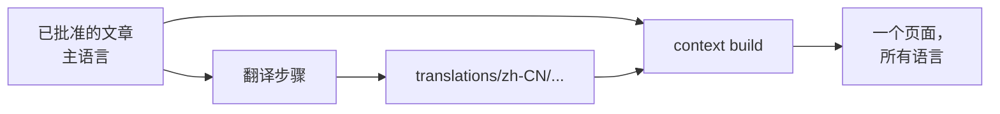

# 多语言站点

<!-- context:section id="goal" -->
Context 站点可以在同一地址下用多种语言显示每个页面。你声明读者语言；Agent 在交付阶段翻译已批准的文章和导航标题；站点为每位读者显示其语言，缺少翻译时则回退到原文。主语言中已批准的知识始终是唯一的真源：翻译只是面向读者的投影，绝不会改变审核、验证或知识包。


<!-- /context:section -->

<!-- context:section id="declare" -->
## 声明语言

```ts
site: {
  lang: "en-US",
  locales: { "zh-CN": { title: "项目知识" } },
}
```

每个 locale 都可以覆盖 `label`、`title`、`description` 和 `home`。只需设置不同的首页字段：未设置的 `home` 标题、标语、描述、首屏操作或资源卡片会先沿用站点自身的 `home` 设置，再回退到内置默认值，因此只翻译标题时，仍会保留主语言的操作按钮和资源卡片。链接、导航和自定义页面都不需要按语言区分路由，因为每个页面都包含所有语言。读者保存的选择优先，其次是浏览器语言，最后是 `site.lang`；该选择保存在 `site.localePreferenceKey` 下（默认为 `context-locale:<package>:<base>`），同一源站下的多个站点可以共享它。即使没有 `site.locales`，语言按钮仍可在中文和英文之间切换界面。
<!-- /context:section -->

<!-- context:section id="storage" -->
## 翻译存放在哪里

| 路径 | 内容 |
| --- | --- |
| `translations/<tag>/<approved-path>.md` | 翻译后的文章；frontmatter 包含 `title`、可选的 `description`，以及一条 `translation` 记录，其中有 locale、文章身份标识、来源摘要和时间 |
| `translations/<tag>/knowledge-map.yaml` | 按知识地图条目索引的翻译后导航标题 |

翻译是 Context 知识工作区的正式内容：它们会被提交，纳入版本和知识包指纹，修改任何一项翻译都会重新构建网站。
<!-- /context:section -->

<!-- context:section id="freshness" -->
## 时效性

每份翻译都会记录它所依据的已批准标题、描述和正文的摘要：

| 状态 | 含义 | 站点上的表现 |
| --- | --- | --- |
| `current` | 摘要一致 | 显示翻译 |
| `stale` | 已批准的文章此后发生了变化 | 显示翻译，并附带过期提示和一个切换到原文的按钮 |
| `missing` | 没有翻译文件 | 显示原文并附带提示 |

运行时元数据的变化不会让翻译过期。如果翻译对应的文章已不存在，它会被报告为孤立翻译，并在下次提交时移除。`context-site-map.json` 会列出每个 locale 已翻译、已过期和缺失的数量。
<!-- /context:section -->

<!-- context:section id="workflow" -->
## 翻译步骤

当知识包声明了 locale 且存在不是最新的内容时，工作流会在知识包模板批准之后、记录知识工作区版本之前加入一个翻译步骤。由 Agent 执行：

```bash
context translate status --format json
context translate prepare --format json
context translate submit --input <file> --format json
context translate skip --digest <expected_digest> --format json
```

`prepare` 会列出待翻译的文章和导航标题，并给出 `expected_digest`；`submit` 接收翻译后的文件和标题：

```yaml
expected_digest: <from prepare>
articles:
  - locale: zh-CN
    approved_path: knowledge/sop/example.md
    file: .tmp/agent-payloads/translations/zh-CN/sop/example.md
map_entries:
  - locale: zh-CN
    key: getting-started
    title: 入门
```

翻译必须保留每个章节标记、id 及其顺序，每个围栏代码块（Mermaid 标签可以修改）以及每个链接目标。提交会作为一个整体进行校验，只要有任何一项失败就不会保存任何内容；在某次已批准的变更之前得到的摘要会被拒绝。`skip` 只在本轮迭代中以主语言发布当前待处理的条目——下一次已批准的变更会再次要求翻译。
<!-- /context:section -->

<!-- context:section id="reading" -->
## 读者看到什么

每个页面只发布一次，包含所有语言，由读者的语言决定显示哪一种。没有翻译的导航标题会使用翻译后的文章标题，再没有则使用原文。搜索覆盖所有语言，打开另一种语言的搜索结果时会切换到该语言。LLM Docs 和 Changelog 保持主语言。关于其他站点选项，请参阅[文档站](documentation-sites.md)。
<!-- /context:section -->
