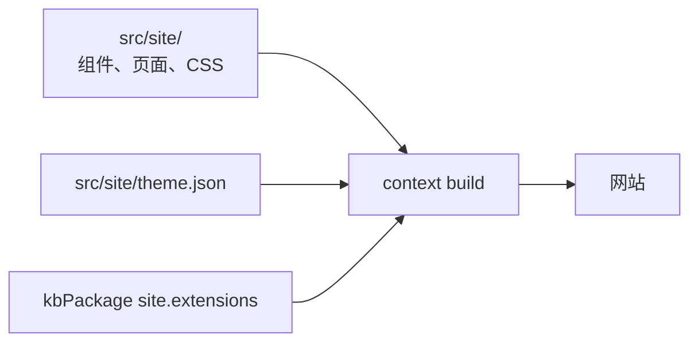

# 页面与主题定制

<!-- context:section id="goal" -->
Context 站点无需任何前端代码即可使用，但你也可以按需定制：替换首页的部分区块、添加 Logo、在每个页面上悬浮一个聊天组件、发布仅属于网站的页面，以及修改配色方案。这些内容都位于你的 Context 知识工作区中——展示代码放在 `src/site/` 下，颜色放在 `src/site/theme.json` 中——并由常规的 `context build` 应用。已批准的知识和生成的产出永远不需要手动编辑。


<!-- /context:section -->

<!-- context:section id="extensions" -->
## 声明扩展

```ts
site: {
  title: "Engineering handbook",
  extensions: {
    root: "src/site",
    slots: {
      banner: "components/Banner.vue",
      floating: "components/Chat.vue",
    },
    pages: { support: "pages/support.md" },
  },
}
```

路径相对于 `root`。该文件夹可以包含 Vue 组件、CSS、Markdown 和被导入的资源；在其中使用相对导入，并在知识工作区的包清单中声明外部依赖。隐藏文件、`node_modules` 和 `dist` 不会被复制，符号链接会被拒绝。永远不要在前端文件中放入凭据或私有配置。
<!-- /context:section -->

<!-- context:section id="slots" -->
## 首页与页面插槽

| 插槽 | 默认内容 | 定制方式 |
| --- | --- | --- |
| `banner` | 首页首屏与操作按钮 | 替换为组件 |
| `knowledge` | 知识地图卡片组 | 替换为组件 |
| `resources` | 资源卡片组 | 替换为组件 |
| `footer` | 首页页脚 | 替换为组件 |
| `floating` | 空 | 仅在客户端渲染的组件，固定在所有页面的右下角 |
| `brand` | 站点标题文字 | 位于顶栏起始处的组件，例如 Logo |

省略某个插槽即保留其默认内容，设为 `false` 则隐藏它。组件只替换它所在的插槽——绝不会替换全局导航、语言切换或文章来源信息。组件可以使用 VitePress 的 `useData()` 和 `useRoute()`，并导入作用域 CSS。页面以浅色主题预渲染；对于保存的选择为深色模式的读者，插槽组件会在加载后重新挂载，使绑定到 `isDark` 的标记保持一致。重新挂载的插槽会先完成加载，再替换预渲染的标记，因此新旧内容在同一帧内切换，主页横幅这类自定义插槽不会塌陷。

如果想从首次绘制起就显示正确的语言，请为每种语言分别渲染内容，并用 `data-context-locales="<tag>"` 标记；站点样式表会隐藏其他语言。挂载后，`useData().lang` 会给出读者的语言。
<!-- /context:section -->

<!-- context:section id="floating" -->
## 聊天或 Bot 组件

`floating` 组件自行负责其按钮、面板和打开／关闭行为。请让面板保持在视口之内，保留键盘焦点和关闭控件，并且只在打开时才加载较重的聊天 SDK。静态站点不提供聊天后端或密钥存储：请把请求发送到你自己的已授权服务，并确保服务故障绝不会妨碍阅读文档。其他组件必须能静态渲染；使用浏览器 API 时请放在 `onMounted` 中。
<!-- /context:section -->

<!-- context:section id="pages" -->
## 自定义页面

每个 `pages` 键都会成为站点 base 下的 `/custom/<key>.html`。页面是受信任的 Markdown，可以导入 Vue 组件：

```md
# Support

<script setup>
import SupportPanel from '../components/SupportPanel.vue'
</script>

<SupportPanel />
```

要把它放进导航，请添加一个普通的知识地图条目，其目标为 `artifact_ref: "site:support"`，并像其他条目一样设置 `parent`、`title` 和 `order`。没有条目的页面仍然可以直接访问，多个条目也可以指向同一个页面。自定义页面只属于网站：它们不是已批准的文章，也不会进入知识包或 LLM Docs。修改正式文章请通过修订，而不是用自定义页面。
<!-- /context:section -->

<!-- context:section id="theme" -->
## 颜色

如果 `src/site/theme.json` 不存在，第一次网站构建会创建它，并写入默认的浅色和深色配色；之后的构建绝不会覆盖你设置的值，删除该文件即可恢复默认值。`light` 和 `dark` 对象都接受 `brand`、`accent`、`background`、`surface`、`text`、`mutedText` 和 `border`，取值为十六进制颜色；缺失的键沿用默认值。

知识包可以覆盖这个共享文件：

```ts
kbPackage({ site: { theme: {
  light: { brand: "#6750a4" }, dark: { brand: "#d0bcff" },
} } })
```

优先级依次为内置默认值、`theme.json`、`site.theme`。无论系统配色如何，网站都以浅色模式打开；读者的浅色／深色选择保存在整个源（origin）共用的 `context-theme` 键下，因此同一源下的站点共享这一选择。离线审核报告和 Mermaid 图表也使用相同的颜色。自定义组件应读取 `--context-brand`、`--context-accent`、`--context-background`、`--context-surface`、`--context-text`、`--context-muted-text` 和 `--context-border`，而不是硬编码颜色。
<!-- /context:section -->

<!-- context:section id="check" -->
## 构建与检查

定制不需要采集、Indexer 工作或新的审核：修改后照常运行构建即可。扩展文件和依赖清单会参与构建指纹，构建失败时会保留之前的产出。发布前，请在桌面端和移动端、在非根路径的 `base` 下、在深色模式下以及使用键盘导航时，预览首页、自定义页面和悬浮面板。只发布网站文件夹。关于站点的基础选项，请参阅[文档站](documentation-sites.md)。
<!-- /context:section -->
