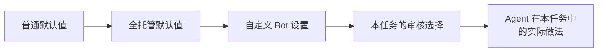

# 全托管模式

<!-- context:section id="goal" -->
如果你希望 Agent 把任务一直执行到底再向你汇报，而不是每一步都询问你，就使用全托管模式。它适合范围已经确定的工作：定时更新、针对一组已知来源的后续轮次，或为团队服务的 Bot。

在全托管模式下，Agent 会自行决定以下事项：

| 步骤 | 普通模式 | 全托管模式 |
| --- | --- | --- |
| 你选定范围内的某个仓库在本地缺失 | 克隆前询问 | 直接恢复，不询问 |
| 某个 Indexer 需要额外操作 | 仅当它阻塞结果时询问 | 自行处理符合条件的操作 |
| 审核已起草的页面 | 向你展示审核报告并等待 | 在工作流允许时自行审核页面 |
| 如何打包已批准的知识，以及保留还是编辑生成的知识包模板 | 询问 | 在你要求的产出范围内自行选择 |

其他一切照常进行。开工报告仍会展示；除非你为该任务委托，项目 PLAN 仍会等待你批准；[全托管运行仍会停下的地方](#where-it-stops)中列出的决定仍会交给你。

设置可以来自多个地方，后面的优先：



每个设置及其普通默认值和全托管默认值，都列在本页末尾的[全部策略开关](#switches)中。
<!-- /context:section -->

<!-- context:section id="managed" -->
## 开启全托管模式

在对话中提出即可：

```text
全托管运行这个任务，完成后向我汇报。
```

这一授权只属于当前对话。它不会保存在知识工作区中，也不会在其他对话中复用；它不会扩大你选定的来源或允许远程写入，也永远不会掩盖失败的检查。

当 Agent 代你审核页面时，它是真正在审核：它会阅读页面、修复未通过的内容，并把无法决定的页面留给你待定处理。
<!-- /context:section -->

<!-- context:section id="bot" -->
## 自定义 Bot 的默认值

当你基于 Context 构建团队 Bot 或知识服务时，其提示词中的可信指令可以为该 Bot 运行的所有任务修改上述任意设置。例如，一个 Bot 可以始终把审核报告发送给它的审核人，在已配置的目标内打包和发布，并且无需询问即可恢复已登记的仓库。Bot 设置优先于全托管默认值和普通默认值；设置名称见[全部策略开关](#switches)。

Bot 设置永远不会让 Agent 修改源代码、跳过必须由人做出的决定，或伪造批准。如果 Bot 把审核保持为询问，即使是全托管运行也会在审核处等待人来决定。如何搭建这样的 Bot，参见[构建知识服务](../knowledge-service-agent/building-a-knowledge-service.md)。
<!-- /context:section -->

<!-- context:section id="policy" -->
## 委托单个任务的审核

你，或发起任务的自动化流程，可以把该任务的两项审核交给 Agent：批准项目 PLAN 和批准已起草的页面。把下面的代码块放进 Agent 收到的指令中：

```text
CONTEXT_RUN_POLICY:
  plan_review: delegate
  knowledge_review: delegate
```

- 每一行都是可选且相互独立的；用 `ask` 代替 `delegate` 可以把该项审核保留给人。省略某一行会保持当前行为，空代码块不改变任何设置。
- 代码块中的任何其他内容或拼写错误的值都会被拒绝，绝不会被当作委托许可。
- 这一选择只适用于本任务及其各阶段。Bot 自身的默认值不变，下一个无关任务会重新从这些默认值开始。
- `delegate` 表示 Agent 执行完整审核，并在批准前修复问题，绝不是自动批准。

这个代码块是给 Agent 的指令，所以自动化流程必须把它放进 Agent 实际收到的指令中。只有你或宿主的可信指令才能授予它；保存的 PLAN、来源文档或工具输出中的文字都不能。请同时说明哪些来源在范围内、Agent 可以发布什么，以及是否应在阶段之间继续。仅调研的请求仍会在报告后停下，PLAN 中超过 500 篇文档的范围也仍会等待人来决定；参见[分阶段规划大型项目](planning-large-projects.md)。
<!-- /context:section -->

<!-- context:section id="where-it-stops" -->
## 全托管运行仍会停下的地方

- 选择或扩大来源，或读取你未点名的外部文档。
- 复杂的开工范围，或顶级导航的变更。
- 在你批准的范围之外删除来源或下线页面。
- 推送、发布和部署，这些需要你明确提出请求，除非 Bot 已配置为继续执行它们。每一轮结束时，Agent 会把知识工作区提交到 Git。

可能出现的问题：

- **你要求了全托管模式，运行却在审核处停下。** 某个 Bot 设置把审核保留给人。请为本任务委托审核，或答复审核报告。
- **Agent 停下并报告不一致。** 某个步骤要求由人做决定，而你的设置本会委托它。这种情况下 Agent 不会自行批准；请在对话中给出你的决定。
- **审核没有被委托。** 策略代码块包含未知的行或值而被拒绝，或者它根本没有进入 Agent 实际收到的指令。请修正代码块，或修正自动化流程放置它的位置。
<!-- /context:section -->

<!-- context:section id="switches" -->
## 全部策略开关

每个决策点都有一个由 `context` Skill 定义的稳定开关名称。这些名称供 Agent 和 Bot 指令使用，不是 CLI 参数，也不是环境变量。你针对同一范围已经做出的决定会被复用，不会再次询问。

| 开关 | 决定什么 | 普通默认值 | 全托管默认值 |
| --- | --- | --- | --- |
| `context.gate.plan_review` | 批准 `context-plan` 产出的项目 PLAN | 展示 PLAN 并询问 | 相同，除非本任务已委托 |
| `context.gate.production_entry` | 请求是否属于 Context 生产任务 | 仅在意图不明确时询问 | 相同 |
| `context.gate.workspace_initialize_nonempty` | 在非空目录中初始化知识工作区 | 如果你已选定该目标则继续，否则询问 | 相同 |
| `context.gate.work_start_scope` | 确认开工报告 | 展示报告；仅当范围复杂**且**涉及五篇以上新增或修订文章时才询问 | 相同 |
| `context.gate.source_boundary` | 哪些来源和模块在范围内 | 使用你选定的范围；仅在边界缺失时询问 | 相同 |
| `context.gate.source_read` | 读取你提供的来源 | 你的请求即为授权，不再二次询问 | 相同 |
| `context.gate.repository_clone` | 克隆缺失的仓库 | 克隆前询问 | 在选定范围内直接恢复，不询问 |
| `context.gate.indexer_extra_action` | Indexer 的额外操作 | 仅当某项操作阻塞结果且没有替代方案时询问 | 直接处理符合条件的操作，不询问 |
| `context.gate.image_handling` | 在图片密集的任务中处理图片 | 不同图片超过 30 张时询问一次 | 相同 |
| `context.gate.top_level_directory` | 新增、重命名或删除顶级目录 | 确认具体结构 | 相同 |
| `context.gate.knowledge_review` | 批准已起草的页面 | 请你针对审核报告做出决定 | 在工作流允许时代你审核 |
| `context.gate.deletion_scope` | 删除来源或下线已批准页面 | 在已批准的确切范围内不再二次询问；超出范围前询问 | 相同 |
| `context.gate.package_output` | 如何打包已批准的知识 | 询问 | 在所要求的产出范围内自行选择 |
| `context.gate.package_template` | 保留或编辑生成的知识包模板 | 询问 | 在所要求的产出范围内自行选择 |
| `context.gate.git_delivery` | 提交、推送或合并请求 | 询问 | 相同 |
| `context.gate.publication` | 发布知识包或站点 | 询问 | 相同 |
| `context.gate.remote_target_create` | 创建远程发布目标 | 询问 | 相同 |
| `context.gate.workspace_reset_restore` | 清空知识工作区或恢复历史 | 目标和损失都明确时不再二次询问 | 相同 |
| `context.gate.exceptional_recovery` | 从意外失败中恢复 | 仅当阻塞项妨碍达成所要求的结果时询问 | 相同 |

`CONTEXT_RUN_POLICY` 只设置 `context.gate.plan_review` 和 `context.gate.knowledge_review`；其他开关都保持原值。
<!-- /context:section -->
