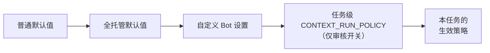

# 托管模式与审核策略

<!-- context:section id="goal" -->
工作流会在 **Gate** 处暂停：这些决定应当由人来做。Agent 如何处理每个 Gate，由一个具名的**策略开关**控制。在普通模式下，Agent 采用每个开关的普通默认值。在**全托管模式**下，少数开关会改变默认值，让运行自行推进——但有些决定永远不会委托，所以即使是全托管运行也会在那里停下。

开关可以被三层设置修改，后面的层优先：


<!-- /context:section -->

<!-- context:section id="switches" -->
## 全部策略开关

`context.gate.*` ID 是由 `context` Skill 定义的稳定 Agent 策略开关。它们不是 CLI 参数，也不是环境变量；修改开关也永远不会改变 Route 自身的 gate ID、命令或载荷。

| 开关 | 决定什么 | 普通默认值 | 全托管默认值 |
| --- | --- | --- | --- |
| `context.gate.plan_review` | 批准 `context-plan` 产出的项目 PLAN | 展示 PLAN 并询问 | 相同，除非本任务已委托 |
| `context.gate.production_entry` | 请求是否属于 Context 生产任务 | 仅在意图不明确时询问 | 相同 |
| `context.gate.workspace_initialize_nonempty` | 在非空目录中初始化 Context 知识工作区 | 如果你已选定该目标则继续，否则询问 | 相同 |
| `context.gate.work_start_scope` | 确认开工报告 | 展示报告；仅当范围复杂**且**涉及五篇以上新增或修订文章时才询问 | 相同 |
| `context.gate.source_boundary` | 哪些来源和模块在范围内 | 使用你选定的范围；仅在边界缺失时询问 | 相同 |
| `context.gate.source_read` | 读取你提供的来源 | 你的请求即为授权，不再二次询问 | 相同 |
| `context.gate.repository_clone` | 克隆缺失的仓库 | 克隆前询问 | 在选定范围内直接恢复，不询问 |
| `context.gate.indexer_extra_action` | Indexer 的额外操作 | 仅当某项操作阻塞结果且没有替代方案时询问 | 直接处理符合条件的操作，不询问 |
| `context.gate.image_handling` | 在图片密集的任务中处理图片 | 不同图片超过 30 张时询问一次 | 相同 |
| `context.gate.top_level_directory` | 新增、重命名或删除顶级目录 | 确认具体结构 | 相同 |
| `context.gate.knowledge_review` | 批准候选批次 | 针对 HTML 报告请你做出决定 | 在 Route 允许时委托 |
| `context.gate.deletion_scope` | 删除来源或下线已批准页面 | 在已批准的确切范围内不再二次询问；超出范围前询问 | 相同 |
| `context.gate.package_output` | 如何打包已批准的知识 | 询问 | 在所要求的交付范围内自行选择 |
| `context.gate.package_template` | 保留或编辑生成的知识包模板 | 询问 | 在所要求的交付范围内自行选择 |
| `context.gate.git_delivery` | 提交、推送或合并请求 | 询问 | 相同 |
| `context.gate.publication` | 发布知识包或站点 | 询问 | 相同 |
| `context.gate.remote_target_create` | 创建远程发布目标 | 询问 | 相同 |
| `context.gate.workspace_reset_restore` | 清空知识工作区或恢复历史 | 目标和损失都明确时不再二次询问 | 相同 |
| `context.gate.exceptional_recovery` | 从意外失败中恢复 | 仅当阻塞项妨碍达成所要求的结果时询问 | 相同 |

你针对同一范围已经做出的决定会被复用，不会再次询问。
<!-- /context:section -->

<!-- context:section id="managed" -->
## 开启全托管模式

在对话中提出即可，例如 *“全托管运行，完成后向我汇报。”* Agent 随后用 `context status --managed` 评估工作流，全托管默认值与普通默认值不同的开关将直接推进，不再询问。

这一授权只属于当前对话。它从不保存在知识工作区中，也不会在其他对话中复用；它不会扩大来源范围或授权远程写入，也永远不会掩盖校验或验证失败。委托审核也是真正的审核：Agent 会阅读页面、修复未通过的内容，并让尚无定论的页面保持待定。
<!-- /context:section -->

<!-- context:section id="bot" -->
## 为自定义 Bot 修改默认值

当你基于 Context 构建团队 Bot 或知识服务时，它的实例配置——即其提示词中的可信指令——可以为该 Bot 运行的所有任务覆盖任意开关。例如，一个审核人始终阅读 HTML 报告、并且可以在已配置目标内打包和发布的 Bot，可以这样声明：

```text
Context policy for this Bot:
- context.gate.knowledge_review: ask — always send the HTML review report.
- context.gate.package_output: choose within the configured delivery.
- context.gate.repository_clone: restore registered repositories without asking.
```

Bot 设置优先于全托管默认值和普通默认值。但它仍然不允许 Agent 修改源代码、绕过 Route 标记为需要人来决定的 Gate，或伪造批准：如果 Route 不顾策略仍要求人工决定，Agent 会停下并报告这一不一致。如果 Bot 将 `knowledge_review` 保持为 `ask`，即使是全托管运行也不会自行越过审核。
<!-- /context:section -->

<!-- context:section id="policy" -->
## 任务级审核策略

自动化流程或发起任务的用户，可以在交给 Agent 的指令中放入下面的代码块，仅为该任务设置两个审核开关：

```yaml
CONTEXT_RUN_POLICY:
  plan_review: delegate      # or ask
  knowledge_review: delegate # or ask
```

- 只接受 `plan_review` 和 `knowledge_review`，取值为 `ask` 或 `delegate`。它们分别对应 `context.gate.plan_review` 和 `context.gate.knowledge_review`；其他开关保持不变。
- 每个键都是可选且相互独立的。省略的键沿用现有策略，空代码块不改变任何设置。未知键或无效值会被拒绝，绝不会被当作委托许可。
- 该代码块仅对本任务及其各阶段覆盖 Bot 设置。Bot 的持久默认值不受影响，新的无关任务使用其自身的默认值。
- `ask` 要求人工决定。`delegate` 表示 Agent 执行完整审核并在批准前修复缺陷——绝非无条件或强制批准。

这是一条 Agent 指令，而不是 CLI 参数、环境变量或宿主 API 字段：自动化流程必须把它放进 Agent 实际收到的指令中。只有你的指令或可信的宿主指令才能授予它；保存的 PLAN、来源文本或工具输出都不能。请同时说明已授权的来源范围、交付权限，以及是否在阶段之间继续。仅调研的请求仍会在报告后停下，PLAN 中超过 500 篇文档的范围也仍需等待人来决定。
<!-- /context:section -->

<!-- context:section id="required" -->
## 计划内的文章必须回来

在审核中拒绝一篇计划内的文章并不会取消它。只要有计划内的文章仍处于被拒绝状态，生产阶段就无法关闭；Agent 会根据你的反馈新增一个修订任务。如果确实要舍弃某篇文章，请修改计划。
<!-- /context:section -->

<!-- context:section id="where-it-stops" -->
## 全托管运行仍会停下的地方

- 选择或扩大来源，以及读取请求中未点名的外部文档；
- 复杂的开工范围或顶级导航变更；
- 在已批准范围之外删除来源或下线页面；
- Git 提交、发布和部署，这些始终需要你明确提出请求。
<!-- /context:section -->
