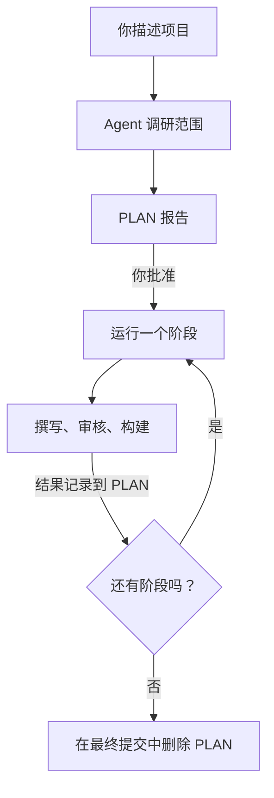

# 分阶段规划大型项目

<!-- context:section id="goal" -->
大型知识项目拆成边界明确的小块更容易做好。**规划模式**，即 `context-plan` Skill，会调研整个范围，提出一份把工作拆分为若干**阶段**的 **PLAN 报告**，然后一次一个阶段地交给普通工作流运行。每个阶段仍有自己的 [开工报告](start-reports.md)、撰写和审核。


<!-- /context:section -->

<!-- context:section id="when" -->
## 什么样的任务算大型任务

当范围包含**超过 30 份来源文档，或至少两个需要深入调研的仓库**，或需要跨来源版本做大范围更新时，分阶段规划。启动一个范围仍需调研的新知识项目，也适合先做规划。边界明确的小任务直接通过 `/c4a:context` 完成。

你可以显式提出、继续一份已有的 PLAN，或者在已授权任务超过阈值时由 `/c4a:context` 转交：

```text
/c4a:context-plan 请帮我们为三个支付服务和设计文档目录建立知识库，读者是新加入的后端工程师。
请分阶段规划，每个阶段完成后汇报一下进展。
```

在 Cursor 中，命令是 `/c4a-context-plan`。如果是包含多个业务方向的超大 monorepo，可能更适合每个方向各建一个知识工作区；规划模式不会自行拆分或迁移已有的知识工作区。
<!-- /context:section -->

<!-- context:section id="research" -->
## 调研期间会发生什么

Agent 在不进入 Git 的临时空间中工作。它从目录列表、版本和已有覆盖情况入手，阅读有代表性的材料和代码入口，只扩展到足以拆分工作的程度。分支或“latest”在用作证据之前，会先固定为确切的提交；PLAN 会为每个来源保留足够的信息，即使临时文件丢失也能恢复。

在提出任何文章之前，它会先阅读知识工作区当前的组织方式和相关的已批准页面，并按主题做出决定：**原样复用**、**修订或扩展**、**合并**、**新增**，或针对尚未解决的冲突或访问缺口**进一步调研**。调研绝不会修改已批准的知识。

大范围更新来源时，每个仓库都会在知识所依据的版本与新版本之间比较，只看已批准文章实际引用的文件。文件有变化只是需要调查的理由，并不证明文章必须重写。


开工之前，规划会问一次是否已有填好的来源清单，并拿到它的链接：填好的清单写明每个来源、负责人，以及知识是否应当依赖它，可以缩短盘点。`context` 技能自带模板，位于 `references/source-checklist.md`。它从来不是必需的——没有清单时，规划按对话里的材料继续。
<!-- /context:section -->

<!-- context:section id="report" -->
## 阅读 PLAN 报告

报告是位于项目 Git 根目录的普通 Markdown。逐部分检查：

| 部分 | 检查什么 |
| --- | --- |
| 目标与当前位置 | 读者和所要求的结果符合你的意图；知识工作区和仓库正确 |
| 调研范围与发现 | 你想要的每个来源都已列出并带有确切版本；访问缺口被明确指出，而不是被隐藏 |
| 已有知识与材料关系 | 与已有页面重叠的部分被复用或修订，而不是重复 |
| 拟定阶段 | 每个阶段都有清晰的读者结果、对应的来源和版本，以及合理的前置条件 |
| 批准与执行选择 | 审核、进度汇报、发布目标和 Git 流程符合你的意图 |
| 当前阶段 | 下一阶段涵盖什么，以及需要保留哪些决定 |
| 结果 | 每个已完成阶段实际产出、审核、发布和提交了什么 |
| 恢复说明 | 工作中断时的确切位置和下一步操作 |

要修改它，直接说出来即可——*“把 S03 拆成参考和指南”*、*“去掉 legacy 文件夹”*。批准 PLAN 并不等于批准任何文章、来源权限、Git 操作或发布。
<!-- /context:section -->

<!-- context:section id="limits" -->
## 阶段规模与大范围项目

这些限制只在这里集中说明：

| 边界 | 默认值 |
| --- | --- |
| 每阶段来源文档数 | 建议 30 份；绝不超过 50 份，超过 30 份的分组需在 PLAN 中记录原因 |
| 新仓库调研 | 每阶段一个仓库；之前调研过的仓库可以支撑后续阶段 |
| 修订阶段 | 最多 30 篇目标文章 |
| 超过 100 份文档 | Agent 会与你确认，有限范围的调研能否确定有用的范围 |
| 超过 500 份文档 | 整个任务暂停，直到有人缩小范围或明确保留全部内容 |

这些是 Agent 遵循的规划边界，而不是工具中的硬性限制。你可能会得到的筛选方式包括：选定目录或领域、排除归档、按最近更新时间截止（附带日期），或只保留长期有效的文档。任何内容都不会被悄悄排除。500 份文档的暂停无法通过委托、全托管模式或定时触发来解除。
<!-- /context:section -->

<!-- context:section id="review" -->
## 谁来审核 PLAN

默认情况下，Agent 会请你审核 PLAN，在全托管模式下也是如此。你可以在某个任务中把这项审核交给 Agent（参见 [全托管模式](managed-mode-and-review-policy.md)）；Agent 随后会阅读整份报告，检查范围、阶段限制、依赖、重叠、证据缺口和发布设置，并在记录决定之前补齐缺失的部分。文章审核是独立的：委托 PLAN 审核不会改变页面的审核方式。

Agent 还会确认你希望如何获知进度：所有阶段完成后汇报一次，还是每个阶段后都汇报——对于阶段汇报，还要确认是自动继续还是等待你的回复。仅调研的请求会在报告后停下；执行计划需要你明确同意。
<!-- /context:section -->

<!-- context:section id="steer" -->
## 尽早引导

在大型任务中，开工报告和第一批改动页面一出现就去预览。如果措辞、示例或风格不对，用反例说明。第一阶段做出的修正会延续到后续每个阶段；修正得越早，最终质量越高。
<!-- /context:section -->

<!-- context:section id="stages" -->
## 运行各阶段

每个阶段只针对自己的范围运行普通工作流，并沿用已批准 PLAN 中的来源、目标文章、复用与修订决定，以及审核、汇报和发布选择。

每个阶段结束后，Agent 会把实际发生的情况——调研、撰写、审核、合并和发布——记录到 PLAN 中，并在下一阶段开始前提交。需要发布的阶段只有在发布成功后才算完成；本地构建或尚未合并的合并请求都不算发布。在进入下一阶段之前，Agent 会重新检查受影响的知识，包括前面阶段的页面，确保不会重复创建或覆盖任何内容。
<!-- /context:section -->

<!-- context:section id="resume" -->
## 中断与收尾

如果会话结束，PLAN 会保留当前位置和下一步操作。在同一个知识工作区中开启新对话并调用 `/c4a:context-plan`，它会恢复当前阶段，而不是重复整个项目的调研。PLAN 中保存的 PLAN 审核委托只是一份记录：恢复时，只有你对该任务的指令仍然授予委托，Agent 才会遵循它。

当所有约定的阶段都已完成并合并后，PLAN 会在最终提交中被删除。它的历史保留在 Git 中。
<!-- /context:section -->
