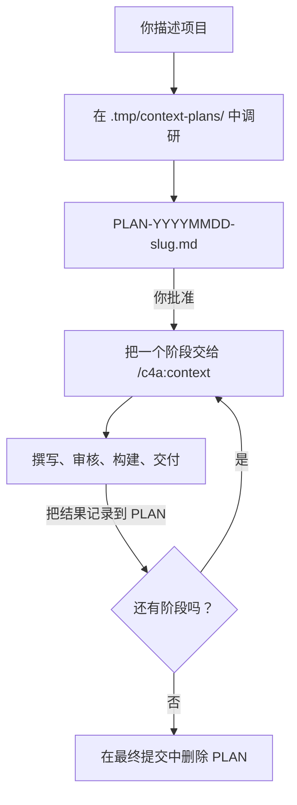

# 规划大型项目

<!-- context:section id="goal" -->
**规划模式**就是 `context-plan` Skill。它把一个大型知识项目变成一份经过审核的 **PLAN 报告**和一系列边界明确的**阶段**，然后一次把一个阶段交给普通的 Context 工作流。它是调研与协调层，而不是第二套工作流引擎：每个阶段仍有自己的开工报告、撰写和知识审核。


<!-- /context:section -->

<!-- context:section id="when" -->
## 何时使用规划模式

当范围包含**超过 30 份来源文档，或至少两个需要深入调研的仓库**，或需要跨来源版本做大范围更新时，使用规划模式。你可以显式调用 `/c4a:context-plan`（Cursor 中为 `/c4a-context-plan`），继续一份已有的 `PLAN-*.md`，或者在已授权任务超过阈值时由 `/c4a:context` 转交。边界明确的小任务直接通过 `/c4a:context` 继续。

```text
/c4a:context-plan 请帮我们为三个支付服务和设计文档目录建立知识库，读者是新加入的后端工程师。
请分阶段安排，每个阶段完成后汇报一下进展。
```

如果是包含多个业务方向的超大 monorepo，可能更适合每个方向各建一个 Context 知识工作区；规划模式不会自行迁移已有的知识工作区。
<!-- /context:section -->

<!-- context:section id="research" -->
## 调研期间会发生什么

Agent 在项目 Git 根目录下的临时空间中工作：

```text
<project-git-root>/
  PLAN-YYYYMMDD-slug.md
  .tmp/context-plans/YYYYMMDD-slug/
    repos/          # 无法复用本地仓库时新检出的代码
    documents/      # 获取的文档正文和资源
    research/       # 清单和调研笔记
    stage-inputs/   # 当前阶段的生产交接材料
```

它从目录元数据、版本和已有覆盖情况入手，阅读有代表性的材料和代码入口，只扩展到足以拆分工作的程度。仓库的 `latest` 或某个分支在用作证据之前，会先解析为确切的提交。临时数据不进入 Git；提交的 PLAN 保留足够的来源标识，即使临时文件丢失也能恢复。

在提出任何文章之前，它会先阅读知识工作区当前的组织方式和相关的已批准页面，并按主题做出决定：**原样复用**、**修订或扩展**、**合并**、**新增**，或针对尚未解决的冲突或访问缺口**进一步调研**。调研对已批准的知识是只读的。

大范围更新来源时，每个仓库都有自己的基线提交和目标提交，只比较已批准文章实际引用的文件。Agent 先比较这些文件在两个提交中的 Git 对象 ID——ID 未变就无需读取内容；在部分克隆（partial clone）中，它把仍需要的对象一次性批量拉取，而不是让每次读取逐个下载文件。文件有变化只是需要调查的候选，并不证明文章必须重写。
<!-- /context:section -->

<!-- context:section id="report" -->
## 阅读 PLAN 报告

报告是位于 Git 根目录的普通 Markdown。逐部分检查：

| 部分 | 检查什么 |
| --- | --- |
| 目标与当前位置 | 读者和所要求的结果符合你的意图；知识工作区和 Git 根目录正确 |
| 调研范围与发现 | 你想要的每个来源都已列出并带有确切版本；访问缺口被明确指出，而不是被隐藏 |
| 已有知识与材料关系 | 与已有页面重叠的部分被复用或修订，而不是重复 |
| 拟定阶段 | 每个阶段都有清晰的读者结果、对应来源和固定的引用，以及合理的前置条件 |
| 批准与执行选择 | 审核策略、汇报方式、交付目标和 Git 流程符合你的意图 |
| 当前阶段交接 | 下一阶段的来源、目标以及需要保留的决定 |
| 结果与同步 | 每个阶段实际的生产、审核、交付、提交和合并状态 |
| 恢复说明 | 工作中断时的确切位置和下一步操作 |

要修改它，直接说出来即可——*“把 S03 拆成参考和指南”*、*“去掉 legacy 文件夹”*。批准 PLAN 并不等于批准任何文章、来源权限、Git 操作或发布。
<!-- /context:section -->

<!-- context:section id="limits" -->
## 阶段规模与大范围项目

| 边界 | 默认值 |
| --- | --- |
| 每阶段来源文档数 | 建议 30 份；绝不超过 50 份，超过 30 份的分组需记录原因 |
| 新仓库调研 | 每阶段一个仓库；已调研过的仓库可以支撑后续阶段 |
| 修订阶段 | 最多 30 篇目标文章 |
| 超过 100 份文档 | Agent 会检查有限范围的调研能否确定有用的范围，并与你确认 |
| 超过 500 份文档 | 整个任务暂停，直到有人缩小范围或明确保留全部内容 |

你可能会得到的筛选方式包括：选定目录或领域、排除归档、按最近更新时间截止（附带日期），或只保留长期有效的文档。任何内容都不会被悄悄排除。500 份文档的暂停无法通过委托、全托管模式或定时触发来解除。
<!-- /context:section -->

<!-- context:section id="review" -->
## 谁来审核 PLAN

PLAN 审核默认询问你，在全托管模式下也是如此。任务可以通过 [`CONTEXT_RUN_POLICY` 代码块](managed-mode-and-review-policy.md)中的 `plan_review: delegate` 把它交给 Agent；Agent 随后会阅读整份报告，检查范围、阶段限制、依赖、重叠、证据缺口和交付设置，并在记录决定之前修复缺陷。文章审核是独立的：委托 PLAN 审核不会改变知识审核。

Agent 还会确认你希望如何获知进度：所有阶段完成后汇报一次，还是每个阶段后都汇报——对于阶段汇报，还要确认是自动继续还是等待你的回复。仅调研的请求会在报告后停下；执行计划需要你明确同意。
<!-- /context:section -->

<!-- context:section id="stages" -->
## 运行各阶段

对每个阶段，Agent 会把 PLAN 路径、阶段 ID、选定的来源和固定的引用、目标文章、复用与修订决定，以及继承的审核、汇报和发布设置交给普通的 `context` Skill。随后生产只针对该范围遵循新的 Route。

每个阶段结束后，它会记录实际的调研、生产、审核、合并和交付结果。需要发布的阶段只有在发布成功后才标记为已交付——本地构建或尚未合并的合并请求都不算发布。在进入下一阶段之前，它会重新检查受影响的知识，包括前面阶段已交付的页面，确保不会重复创建或覆盖任何内容。
<!-- /context:section -->

<!-- context:section id="resume" -->
## 中断与收尾

如果会话结束，PLAN 会保留当前位置和下一步操作。在同一个知识工作区中开启新对话并调用 `/c4a:context-plan`，它会恢复当前阶段，而不是重复整个项目的调研。PLAN 中保存的审核策略只是一份记录：恢复时，只有可信的任务指令仍然授予委托，委托才会生效。

当所有约定的阶段都已交付、集成也已解决时，PLAN 会在获得授权的最终提交中被删除。它的历史保留在 Git 中。

简要概览参见[大型项目](../../product/getting-started/large-projects.md)。
<!-- /context:section -->
