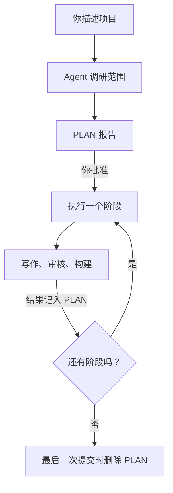

# 分阶段规划大型项目

<!-- context:section id="goal" -->
大型知识项目拆成边界清楚的小块，更容易做好。**规划模式**（即 `context-plan` Skill）会先调研整个范围，提出一份把工作拆成若干**阶段**的 **PLAN 报告**，再一次交一个阶段给普通工作流执行。每个阶段照常有自己的[确认开工报告](start-reports.md)、写作和审核。


<!-- /context:section -->

<!-- context:section id="when" -->
## 什么样的任务算大型任务

范围内有**超过 30 份来源文档，或至少两个需要深入调研的仓库**，或者要跨多个来源版本做大范围更新时，就应该分阶段规划。新建一个范围还不清楚、需要先调研的知识项目，也适合先做规划。边界清楚的小任务直接用 `/c4a:context` 完成即可。

你可以主动提出，可以接着一份已有的 PLAN 继续做；已授权的任务超出上述门槛时，`/c4a:context` 也会转交给规划模式：

```text
/c4a:context-plan 请帮我们为三个支付服务和设计文档目录建立知识库，读者是新加入的后端工程师。
请分阶段规划，每个阶段完成后汇报一下进展。
```

在 Cursor 中，命令是 `/c4a-context-plan`。如果是包含多个业务方向的超大 monorepo，可能更适合每个方向各建一个知识工作区；规划模式不会自行拆分或迁移已有的知识工作区。
<!-- /context:section -->

<!-- context:section id="research" -->
## 调研时会做什么

Agent 在不进入 Git 的临时目录里工作，**第一步是确认目的和约束**。它会先读你已经给出的材料（会议纪要、方案、填好的来源清单、以前的 PLAN），然后把还不清楚的问题一次问完：

- 知识现在放在哪里、由谁维护，以后是继续在原处维护，还是迁进知识工作区；
- 哪些内容必须保留原有措辞；
- 谁会阅读结果（编码 Agent、问答、值班、新人上手），不同读者是否需要各自的知识包；
- 结构上有哪些限制，例如保留现有的顶层目录。

“还没定”也是有效的回答，会记为待定事项，不影响调研继续。这些回答之后就是评判调研和报告的标准。

接下来，Agent 从目录列表、版本和现有覆盖情况入手，阅读有代表性的资料和代码入口，读到足以拆分工作为止。分支或“latest”在用作依据之前，会先固定到确切的提交；PLAN 会为每个来源记下足够的信息，临时文件丢了也能恢复。

提出任何文章之前，它会先看知识工作区现在的组织方式和相关的已批准页面，再按主题决定：**直接复用**、**修订或扩充**、**合并**、**新增**，或者因为还有未解决的冲突或访问缺口而**继续调研**。调研期间绝不会修改已批准的知识。

**如果你带来了已有的知识资料集**（wiki 或知识仓库、文档目录、另一个工作区或已发布的知识包），Agent 还会判断每个资料集的类型和真正的上游，并在固定版本的代码上为每个资料集核对十条左右的具体说法。每条说法判为一致、部分一致、不一致或无法核实，有问题的再分成*写错*和*过时*两类。根据这些依据，它给每个资料集的各种接入方式打分；有哪些方式可选，见[迁移已有知识库](../practices/migrating-a-knowledge-base.md)。

大范围更新来源时，每个仓库都会比较知识当初依据的版本和新版本，只看已批准文章实际引用到的文件。文件有变化只说明需要检查，并不说明文章一定要重写。

规划时会问一次你有没有填好的来源清单，有的话请给出链接。`context` 技能自带模板，位于 `references/source-checklist.md`。清单从来不是必需的：没有清单，就按对话里提供的资料继续。
<!-- /context:section -->

<!-- context:section id="report" -->
## 阅读 PLAN 报告

需要在几种方式之间取舍，或者调研涉及已有知识资料集时，Agent 会先给你一份**调研报告**。这是一个单页 HTML，由几节 Markdown 通过技能自带的模板（`templates/research-report/build.mjs`，无依赖）生成。报告开头就是结论：现状、每个资料集的建议及其收益和成本、下一步；后面依次是各种方式及评分、推荐方案、对导航的影响、各知识包及其文章、与已有知识的对比、核对结果和背景。每一节也都先给出本节结论。讨论中你做的决定，会在请你批准之前记进 PLAN。

PLAN 本身是放在项目 Git 根目录的普通 Markdown 文件。可以按下表逐部分检查：

| 部分 | 检查什么 |
| --- | --- |
| 目标与当前位置 | 读者和期望的结果符合你的意图；知识工作区和仓库都对 |
| 目的、约束与决定 | 你的回答、从文档中推导出的内容、已记录的决定和待定事项都和你想的一样 |
| 调研范围与发现 | 你想要的来源都已列出，并带有确切版本；访问缺口明确写出，没有被隐藏 |
| 已有知识资料集 | 每个资料集的类型、维护情况、上游、独有内容、核对结果，以及选定的方式和理由 |
| 已有知识与资料的关系 | 与已有页面重叠的部分是复用或修订，而不是重复写一遍 |
| 目标结构与知识包 | 导航如何变化，每个知识包面向谁、包含哪些文章 |
| 拟定阶段 | 每个阶段的读者收获清楚，来源和版本对得上，前置条件合理 |
| 审批与执行选择 | 审核、进度汇报、发布目标和 Git 流程符合你的意图 |
| 当前阶段 | 下一阶段做什么，哪些决定需要沿用 |
| 结果 | 每个已完成阶段实际产出、审核、发布和提交了什么 |
| 恢复说明 | 工作中断时停在哪里，下一步做什么 |

想改哪里直接说，比如*“把 S03 拆成参考和指南”*、*“去掉 legacy 文件夹”*。批准 PLAN 不等于批准任何文章、来源权限、Git 操作或发布。
<!-- /context:section -->

<!-- context:section id="limits" -->
## 阶段规模与大范围项目

这些限制统一在这里说明：

| 范围 | 默认值 |
| --- | --- |
| 每个阶段的来源文档数 | 建议 30 份，最多 50 份；超过 30 份的分组要在 PLAN 中写明原因 |
| 新仓库调研 | 每个阶段一个仓库；之前调研过的仓库可以供后续阶段使用 |
| 修订阶段 | 最多 30 篇目标文章 |
| 超过 100 份文档 | Agent 会和你确认，有限范围的调研能否框定一个有用的范围 |
| 超过 500 份文档 | 整个任务暂停，直到有人缩小范围或明确保留全部内容 |

这些是 Agent 遵守的规划边界，不是工具里的硬性限制。可能给你的筛选方式包括：只选部分目录或领域、排除归档、按最近更新时间截止（注明日期），或只保留长期有效的文档。任何内容都不会被悄悄排除。500 份文档时的暂停，不能通过委托审核、全托管模式或定时触发来跳过。
<!-- /context:section -->

<!-- context:section id="review" -->
## 谁来审核 PLAN

默认由你审核 PLAN，全托管模式下也一样。你可以在某个任务里把这项审核交给 Agent（参见[全托管模式](managed-mode-and-review-policy.md)）；这时 Agent 会通读整份报告，检查范围、阶段限制、依赖、重叠、依据缺口和发布设置，补齐缺失的部分后再记录决定。文章审核是另一回事：委托 PLAN 审核不会改变页面的审核方式。

Agent 还会确认你希望怎样获知进度：全部阶段完成后汇报一次，还是每个阶段结束都汇报；如果按阶段汇报，还要确认是自动继续还是等你回复。只要求调研的请求会在报告后停下；执行计划需要你明确同意。
<!-- /context:section -->

<!-- context:section id="steer" -->
## 尽早把握方向

大型任务中，确认开工报告和第一批改动页面一出来就去预览。如果措辞、示例或风格不对，举出反例说明。第一阶段做的修正会延续到后面每个阶段；纠正得越早，最终质量越高。
<!-- /context:section -->

<!-- context:section id="stages" -->
## 执行各阶段

每个阶段只针对自己的范围执行普通工作流，并沿用已批准 PLAN 中的来源、目标文章、复用和修订决定，以及审核、汇报和发布方面的选择。

每个阶段结束后，Agent 会把实际情况（调研、写作、审核、合并和发布）记进 PLAN，并在下一阶段开始前提交。需要发布的阶段，发布成功才算完成；本地构建或还没合并的合并请求都不算发布。进入下一阶段之前，Agent 会重新检查受影响的知识，包括前面阶段的页面，确保不会重复创建或覆盖任何内容。
<!-- /context:section -->

<!-- context:section id="resume" -->
## 中断与收尾

会话结束时，PLAN 会记着当前进度和下一步。在同一个知识工作区开新对话并调用 `/c4a:context-plan`，它会接着当前阶段继续，而不会把整个项目重新调研一遍。PLAN 里记下的“委托 PLAN 审核”只是记录：恢复时，只有你对这个任务的指令仍然授予委托，Agent 才会照此执行。

约定的阶段全部完成并合并后，PLAN 会在最后一次提交中删除，历史仍保留在 Git 里。
<!-- /context:section -->
