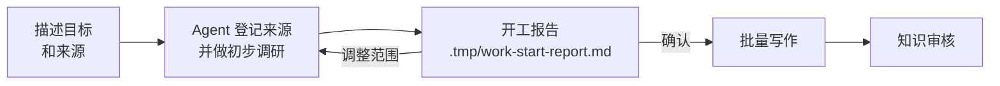

# 开工报告

<!-- context:section id="goal" -->
Agent 批量写页面之前，会先给你一份**开工报告**：它在来源中发现了什么、计划写哪些文章、这些文章将如何组织。这是你调整方向成本最低的时机。改计划只需一句话；改三十篇已写好的页面则要多走一轮修订。

<!-- /context:section -->

<!-- context:section id="before" -->
## 如何走到这一步

先自由描述：知识要覆盖什么、来自哪里（仓库、模块、文档链接），以及你期望的形式——给 Agent 用的知识包、站点，或两者都要。Agent 会调研有代表性的材料，只就会改变范围或产出的缺口向你提问。它不会走一套固定问卷，全托管模式也不意味着可以替你猜答案。

首次构建时，Agent 会登记并采集已确认的来源，提取代码骨架和文档大纲，之后才撰写报告。它不会先把每处实现都深读一遍；范围较广时应先做横向摸底。
<!-- /context:section -->

<!-- context:section id="contents" -->
## 报告包含什么

报告使用你的语言撰写，存放在 `.tmp/` 下，并随任务调整内容。常见章节如下：

| 章节 | 关注点 |
| --- | --- |
| 读者、目标与本次交付 | 谁使用这些知识、完整的目标成果，以及第一批交付什么 |
| 材料能支撑什么 | 已核实的主题与暂定主题，以及尚未调研的部分 |
| 文章与批次 | 每个读者主题、新建还是已有文章、支撑来源，以及深度：入口页、讲解还是操作步骤 |
| 阅读组织 | 建议的导航；对于新站点，给出顶层分组草图、一个代表性菜单和页面大纲 |
| 索引指引 | 哪些 Indexer Skill 用于哪些来源 |
| 决策与缺口 | 已确认的选择与建议、冲突、排除项以及未核查的覆盖范围 |

材料数、文章数和已调研范围分开统计，未知的总数绝不显示为零。第一批交付也不会被当作整体目标呈现。
<!-- /context:section -->

<!-- context:section id="answer" -->
## 如何回复

用自然语言回复即可：确认，或者说明要改什么。你提出的修改会在 Agent 记录你的确认之前完成。

当范围复杂且涉及五篇以上文章，或有单独的决策待定时，Agent 会向你提问——最常见的是**顶层导航变更**，它总会展示变更前后的目录树，并需要你单独明确答复。如果任务涉及超过 30 张不同的图片且没有既定策略，报告也会询问如何处理。小而明确的任务——几篇文档、一个模块、一次修订——只会给出简短方案，而你之前提出的具体请求可能已经涵盖了它。

沉默、时间流逝、提问和异议都不算批准。对未变更计划的批准会延续到后续批次和重试；一旦计划有实质变化或范围扩大，就会重新交给你确认。
<!-- /context:section -->

<!-- context:section id="large" -->
## 大型项目

如果工作涉及超过 30 份来源文档，或需要对两个及以上仓库做实质性调研，`context-plan` Skill 会先产出一份项目 PLAN，把工作拆成若干阶段。之后每个阶段在已批准的计划内各自产出开工报告。参见[大型项目](../../product/getting-started/large-projects.md)。
<!-- /context:section -->
