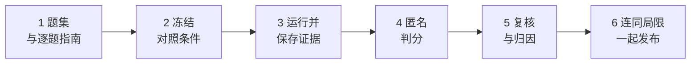

# 评测知识库效果

<!-- context:section id="goal" -->
回答的质量和速度取决于知识本身——是否准确、完整、能链接到证据——也取决于模型、运行环境、检索规划和工具的执行方式。好的测评会在真实问题上，把你的知识库与另一种方案或它自己的早期版本做比较，再借助运行轨迹找出回答慢或错的*原因*。

本页是设计指南：可以照着做，也可以交给 Agent，为你自己的业务规划一次测评。具体的判分、统计和计时规则见[测评评分与计时标准](./evaluation-standard.md)；完整的实测示例见[知识检索测评](../../architecture/benchmark/knowledge-retrieval.md)。


<!-- /context:section -->

<!-- context:section id="scope" -->
## 先确定测什么

- **评价用户实际收到的最终回答。**问两件事：核心结论是否正确？是否交付了问题要求的内容？轨迹用来解释检索、工具和耗时；不要求 Agent 展示推理或复述查证过程。
- **质量、端到端耗时和可见工具调用次数分别报告。**不要用随意的权重把它们合成一个分数。
- **比较的是整体方案。**即使模型相同，知识组织、系统提示、工具、权限和运行环境也可能不同，所以并非所有差异都来自知识库。
- **说明不在范围内的部分。**用已部署的知识作答是一回事；生产和更新知识——它的质量、耗时、审核工作量和成本——是另一回事，需要单独测评。
<!-- /context:section -->

<!-- context:section id="questions" -->
## 建立并冻结题集

1. **从真实用户问题中抽样。**保留原始措辞、必要上下文和术语。相连的追问可以合并成一次冻结输入，但绝不能加入答案提示、来源路径、额外的定位词或评分要求。
2. **每题给一个稳定 ID 并保留出处。**发给 Agent 的输入只包含用户的问题——不带 ID、历史答案、评分表或参考证据。
3. **图片无法同样地发给每种方案时，转成忠实的文字**；看不清的部分标为未知。缺了图片就无法作答的题先排除，在后续版本中再补入。
4. **区分规则说明、代码查证和现场排障。**不要暗中补上用户从未给出的线上权限、部署版本或真实请求。
5. **冻结题单并记录其哈希。**已经被用来调提示词或补知识缺口的题属于*回归集*；另外保留没见过的*保留题*，检查改进能否泛化。
6. **覆盖人们实际会问的问题类型**——例如定位接口和页面、交互规则、参数、权限与角色、版本与调用关系、调试与环境。
<!-- /context:section -->

<!-- context:section id="guides" -->
## 为每道题写一份指南

每道题单独一个文件，包含：

- 原样的测试输入；
- 核实日期、来源版本（固定的提交）以及尚未核实的范围；
- 已确认的参考事实，以及结论成立的条件；
- 回答必须交付的内容；
- 可接受的等价表述、其他有效解法，以及**不强求**的内容；
- 四档结果各自的具体判据，以及能推翻错误断言的反例；
- 证据所在位置、它支持哪项事实，以及已知缺口。

参考答案用于核实事实。它不规定篇幅、标题、引用数量、工具顺序或完整的查证链，也不是要照抄的模板。只停留在 Agent 过程里、没有交付给用户的结论不算数。决定性事实无法核实时，标为待核验，不要拿之前某个助手的回答或某个知识页当作证据。如果后来发现指南不完整，带着证据记录勘误，而不是把所有与旧指南不一致的回答都判错。
<!-- /context:section -->

<!-- context:section id="freeze" -->
## 冻结对照条件

把所有可能影响结果的因素固定下来并记录：

- 题面、模型与推理设置、知识与源码范围、系统提示、工具权限、运行区域和日期；
- 方案是**只用知识**作答，还是**知识加源码核查**——绝不能只让一方读源码而不说明；
- 缓存与长期记忆状态、并发、运行顺序和重复次数。

每道题都新开一个任务，并给每种方案发送完全相同的文本。判分指南绝不进入作答上下文。默认建议**每题运行三次、并发为一、交错各方案的运行顺序**，并记录顺序或随机种子；选择其他做法时要明确说明。题集、指南或配置每改动一次，就使用新版本和新的结果目录；旧材料保留，复跑不覆盖之前的结果。
<!-- /context:section -->

<!-- context:section id="run" -->
## 运行并保存证据

每次尝试都要保存：带时区的开始和结束时间戳、任务或会话 ID 与链接、完整的最终回答、原始工具事件、状态、计时精度以及任何异常。第一条进度消息不是答案；即使平台把任务标为完成，也要确认答案确实已经交付。

保留平台失败、超时、取消、配额拒绝和重试的原始回执。额外的运行要关联到它所重复的那次尝试；绝不能从多次结果中挑最好的一次替换。如果某道题需要用户补充信息，为所有方案定义同一套多轮协议，并标注任何临时追问或恢复。

如果被测 Agent 是为聊天渠道配置的——例如它会拼装回复卡片——直接调用测评时它仍可能执行渠道检测和卡片准备。要单独测量作答，改用适合直接调用的回复策略，或把这部分开销单独记录。
<!-- /context:section -->

<!-- context:section id="grade" -->
## 匿名判分，再复核

- 每道题给每个回答一个随机别名，并记录随机种子。初评者既看不到方案，也看不到耗时、工具次数或之前的分数。回答里的链接或措辞仍可能暴露来源，所以应称之为*有限*匿名。
- 先排查实质错误，再判断问题是否被完整回答，然后给出四档之一——决定性事实暂时无法核实时，标为*待核验*。规则见[标准](./evaluation-standard.md)。
- 复核全部实质错误、待核验、部分解决和边界判定，并抽查完全解决。评审必须给出别人可以复核的理由；篇幅、文风、工具顺序和是否展示过程本身都不能作为理由。
- 用单独的校准样例检查评审一致性：同样的事实写成短版和长版、段落和表格，以及同一对回答交换展示顺序，都应得到相同的判定。没有人工标注样本时，应称之为*内部一致性复核*，而不是人工校准。
<!-- /context:section -->

<!-- context:section id="causes" -->
## 找出原因

数字说明*存在*慢或错；轨迹说明*为什么*。判分完成之后，才揭示每个回答来自哪种方案，再阅读原始工具轨迹，给每个差距归类：

- **知识有误或缺失**——知识库没有覆盖该事实，或写错了。
- **遗漏了关键条件**——例如组件的分支条件，导致回答过度概括。这类缺口应转为修订任务。
- **搜索范围判断错误**——例如根据局部检出就得出“没有任何地方调用它”的结论。
- **推断或归纳错误**，或**漏交付**——Agent 知道，却没有告诉用户。
- **证据不可达**、**重复搜索**、**渠道开销**或**等待启动**。

日志只能支持它实际显示的行为，相关也不等于因果。工具调用多不代表更认真，更快也不代表更准确。
<!-- /context:section -->

<!-- context:section id="disclose" -->
## 连同局限一起发布结果

给出四档数量及其分母、平均与 P50、P90 耗时、可见工具调用次数，以及样本和协议。既在全部题上比较，*也*在各方案都完全解决的子集上比较。把每道题链接到它的回答、指南、判分、计时和证据，并用清单和哈希封存原始数据包。

写明读者解读这些数字所需的一切：每道题运行了几次（只运行一次无法说明稳定性），环境、系统提示、模型、版本、日期、并发和超时的差异，题目是否事先见过，有几位评审、是否经过校准，计时包含什么，以及成本数字是如何估算的。每个改进数字都要标明是实测、条件估算（附公式与假设）还是待验证方向。
<!-- /context:section -->

<!-- context:section id="deliverables" -->
## 测评应产出什么

针对目标业务：一份带出处的问题文档、一份独立的评分标准、每题一份指南、一份采集计划（配置、重复次数、顺序、超时、记录字段）、一个原始记录目录，以及一份汇总报告。在运行任何 Agent 之前先冻结题目和判据。新的业务要自行核实来源、题目范围、必要条件和反例，不沿用其他业务的事实判断。
<!-- /context:section -->

<!-- context:section id="agent-prompt" -->
## 交给 Agent 设计

只要先读本页和标准，Agent 就能起草整份方案。复制下面的提示词，填好方括号里的内容，并在任何运行之前审阅结果：

```text
请先阅读 Context 文档中“评测”分组的三篇文章：
https://context4ai.org/context/llms.txt 中的“评测你的知识库”“评测评分与计时标准”和“知识检索基准测试”。
然后为 [business area] 设计一项评测，将 [knowledge base or assistant] 与 [baseline or
earlier version] 进行比较。

请先准备以下材料，暂不执行评测：
1. 问题文档：从 [where] 选取 20–30 个真实用户问题，每题保留稳定的 ID、来源、固定的题面和问题类型。
2. 评分标准：参考文档中的标准，明确两项主要指标、实质性错误、四档评分和待核验状态。
3. 每题的评分指南：列出已核对的事实及固定来源版本、必需交付、可接受的替代方案、
   不要求的内容、评分条件、反例和证据位置。尚未核实的内容请标明。
4. 采集方案：说明需要固定的配置、重复次数、顺序或随机种子、并发数、超时、计时事件和记录字段。
5. 盲评与复核方案，以及报告大纲和适用边界。

请不要直接套用文档示例中的事实，也不要在题面中加入提示。
需要我决定的事项，请一并列出来。
```
<!-- /context:section -->
