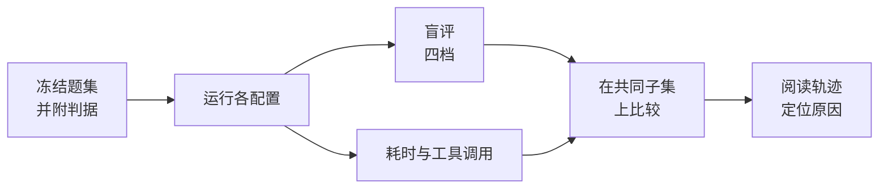

# 评测知识库效果

<!-- context:section id="goal" -->
回答的质量和速度取决于知识本身（准确性、完整性以及与证据的关联），也取决于模型、运行时、检索规划和工具的执行方式。好的评估会在真实问题上，把你的知识库与另一种方案或它自己的早期版本做比较，再借助运行轨迹找出回答慢或出错的*原因*。

<!-- /context:section -->

<!-- context:section id="questions" -->
## 构建题集

- 使用**真实的开发者问题**，覆盖大家实际会问的各类问题：定位接口或页面、交互规则、参数、权限、版本差异、调试和环境。
- 在运行任何测试之前**冻结题集**，避免它逐渐偏向某个配置恰好擅长回答的问题。
- **提前为每道题写好判据。**
<!-- /context:section -->

<!-- context:section id="measure" -->
## 评分与测量

- 按判据把每个回答评为**四档**之一：完全解决、部分解决、实质错误、未作答。
- 坚持**盲评**：评审者（模型或人）不应知道回答来自哪个配置。如果模型评审者未经过与人工评分的校准，应作为局限说明。
- 测量调用方视角的**端到端耗时**，直到完整回答返回为止。报告平均值、P50 和 P90（最近秩法）。
- 统计 Agent 可见的**工具调用**次数。
<!-- /context:section -->

<!-- context:section id="compare" -->
## 公平比较

- 为消除题目难度差异，还要在**共同子集**上比较，即所有配置都完全解决的那些题。
- 尽可能一次只改变一个因素。如果一次比较同时改变了知识配置和模型，就增加一组**同模型对照**，分别隔离各自的影响。
<!-- /context:section -->

<!-- context:section id="causes" -->
## 定位原因

数字告诉你*哪里*慢或出错，轨迹告诉你*为什么*。阅读运行轨迹，并对看到的情况分类：

- **知识缺失**：知识库完全没有覆盖这个事实。
- **遗漏关键条件**：例如遗漏了某个组件的分支条件，导致回答过度泛化。把这类缺口转成修订任务。
- **重复搜索**：Agent 一直在探索，而不是去阅读。
- **等待启动**：环境准备占据了大部分时间。
- **工具开销**：大量调用花在准备仓库、执行 shell 和读取文件上。在固定版本上远程读取代码可以替代其中的大部分。
<!-- /context:section -->

<!-- context:section id="disclose" -->
## 连同局限一起公布数字

说明读者解读结果所需的条件：每道题运行了几次（单次运行无法说明稳定性）、环境之间的差异、系统提示词、模型、版本、日期和超时设置、题目是否事先见过、由几位评审者评分、耗时包含哪些部分，以及成本数字是如何估算的。

一个附带自身局限说明的完整示例见[知识检索测评](../../architecture/benchmark/knowledge-retrieval.md)。
<!-- /context:section -->
