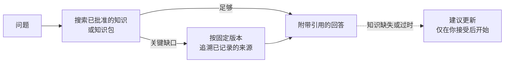

# 提问

<!-- context:section id="goal" -->
`/c4a:context-inspect-search` 基于已批准的知识回答问题，并把答案追溯到来源。它会先读知识，因为结论已经在那里梳理好了；只有当知识留下的缺口可能改变答案时，它才会去读原始文档或代码。每个回答都会引用实际读过的内容。


<!-- /context:section -->

<!-- context:section id="ask" -->
## 提问方式

```text
/c4a:context-inspect-search 服务商已经确认退款了，为什么状态还停留在 pending？
请帮我找一下原因，并引用相关代码。
```

知识工作区不是必需的：该 Skill 可以只基于已安装或提供的知识包作答。查询是只读的——它从不修改来源登记、快照、任务、批准或你的代码检出，也从不为了回答而执行构建。
<!-- /context:section -->

<!-- context:section id="search" -->
## 如何搜索

- 它用业务术语、符号和同义词搜索已批准的 `knowledge/`，依据匹配摘录而不是文件名来选择文章，并连同适用条件阅读相关章节。
- 没有命中时会放宽或换用等价词；结果太杂时会缩小路径。单次未命中并不能证明某样东西不存在。
- 当知识留下的缺口可能改变结论时，它会直接追溯已记录的来源，使用知识所引用的 commit 或快照——绝不用默认分支代替。某个来源读取失败，只影响依赖它的那些论断。
- 如果知识已经回答了问题，它不会恢复代码，也不会逐一检查所有关联来源。
<!-- /context:section -->

<!-- context:section id="modes" -->
## 检索顺序与访问方式

宿主或 Bot 配置可以设置两个相互独立的策略：

| 设置 | 取值 | 效果 |
| --- | --- | --- |
| `CONTEXT_QUERY_SOURCE_MODE` | `repo-first`（默认）、`package-first`、`dual` | 先读知识工作区中已批准的知识、先读知识包，或同时读取两者并调和差异 |
| `CONTEXT_QUERY_ACCESS_MODE` | `auto`（默认）、`remote`、`local` | 通过远程只读代码服务还是本地代码检出来读取知识和代码 |

它们改变的是顺序和访问路径，而不是什么算作证据。使用 `remote` 时，参见[远程读取代码证据](reading-code-evidence-remotely.md)。
<!-- /context:section -->

<!-- context:section id="answer" -->
## 回答是什么样的

答案放在最前面，会改变答案的条件紧随其旁。复杂问题还会给出结果背后的机制，并在有助于你核实时附上简短摘录。实现、声明的契约、测试、运行时观察和推断会被明确区分。

引用会链接到实际读过的内容：所检查 commit 下的源文件、知识站点文章和原始文档。没有可靠链接时，会给出可核查的路径、符号和简短摘录。站点链接来自知识包的 `context-site-map.json`；链接并不代表站点已经部署了该版本。
<!-- /context:section -->

<!-- context:section id="gaps" -->
## 知识缺失时

该 Skill 会把任何缺口限定在它所检查的范围内——某篇文章中未回答的问题，并不等于整个知识库都没有。有支持证据时，它可能会建议更新：受影响的页面或缺口、拟议的修改以及来源范围。在你接受之前什么都不会开始；接受后，它会移交给所选知识工作区的生产入口。参见[从对话中采集](../updates-and-versions/capturing-from-conversations.md)。
<!-- /context:section -->
