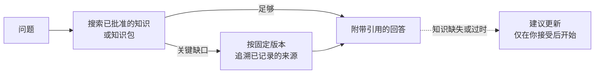

# 提问

<!-- context:section id="goal" -->
`/c4a:context-inspect-search`（Cursor 中为 `/c4a-context-inspect-search`）基于已批准的知识回答问题，并把答案追溯到来源。它会先读知识，因为结论已经在那里梳理好了；只有当知识留下的缺口可能改变答案时，它才会去读原始文档或代码。每个回答都会引用实际读过的内容。


<!-- /context:section -->

<!-- context:section id="ask" -->
## 提问方式

```text
/c4a:context-inspect-search 服务商已经确认退款了，为什么状态还停留在
pending？请引用相关代码。
```

提问从不改变任何东西：它不会触碰你的来源、已批准的页面、任务或代码检出，也从不为了回答而执行构建。
<!-- /context:section -->

<!-- context:section id="modes" -->
## 在知识工作区中提问，或基于知识包提问

你可以在两个地方提问：

- **在知识工作区中**——即生产知识的文件夹。Agent 读取其中已批准的页面，必要时再读取这些页面所依据的来源。
- **基于已安装的知识包**——不需要知识工作区。Agent 读取你安装或获得的知识包，并且仍然可以沿着其中的来源引用回到原始文档和代码。参见 [在 Agent 中使用知识包](using-packages-in-agents.md)。

先读哪一个，以及代码是通过远程只读服务读取还是从本地检出读取，可以由宿主或 Bot 设置；参见 [构建知识服务](../knowledge-service-agent/building-a-knowledge-service.md#configuring-the-bot)。这些设置改变的是顺序和访问路径，而不是什么算作证据。要在没有本地检出的情况下读取代码，参见 [远程读取代码证据](reading-code-evidence-remotely.md)。
<!-- /context:section -->

<!-- context:section id="good-questions" -->
## 如何问出好问题

- **具体一些。** 指明你关心的行为、错误或决策，而不是笼统的整个领域。
- **说明模块或任务。** “在 refunds 模块中……”或“我正在给……加重试”能缩小搜索范围，让回答更聚焦。
- **需要据此行动时要求引用**——比如“引用代码”或“附上页面链接”。
- **追问缺口。** 如果回答说知识没有覆盖某些内容，可以让 Agent 去查来源，或建议一次更新。

```text
/c4a:context-inspect-search 在 billing-service 的 invoicing 模块中，
创建发票时税务查询超时会发生什么？请引用代码和相关的知识页面。
```
<!-- /context:section -->

<!-- context:section id="search" -->
## 如何搜索

- 它用业务术语、符号和同义词搜索已批准的页面，依据匹配结果而不是文件名来选择文章，并连同适用条件阅读相关章节。
- 没有命中时会放宽或换用等价词；结果太多时会缩小搜索范围。单次未命中并不意味着某样东西不存在。
- 当知识留下的缺口可能改变结论时，它会直接读取已记录的来源，使用知识所引用的版本——而不是默认分支上最新的内容。某个来源无法读取，只影响依赖它的那些论断。
- 如果知识已经回答了问题，它不会去拉取代码，也不会逐一检查所有关联来源。
<!-- /context:section -->

<!-- context:section id="answer" -->
## 回答是什么样的

答案放在最前面，会改变答案的条件紧随其旁。复杂问题还会给出结果背后的机制，并在有助于你核实时附上简短摘录。实现、声明的契约、测试、运行时观察和推断会被明确区分。

引用会链接到实际读过的内容：所检查版本下的源文件、知识站点文章和原始文档。没有可靠链接时，会给出可核查的路径、符号和简短摘录。站点链接并不代表站点已经部署了该版本。
<!-- /context:section -->

<!-- context:section id="gaps" -->
## 知识缺失时

缺口限定在所检查的范围内——某篇文章中未回答的问题，并不等于整个知识库都没有。有支持证据时，Agent 可能会建议更新：受影响的页面或缺口、拟议的修改以及涉及的来源。在你接受之前什么都不会开始。参见 [从对话中采集](../updates-and-versions/capturing-from-conversations.md)。
<!-- /context:section -->
