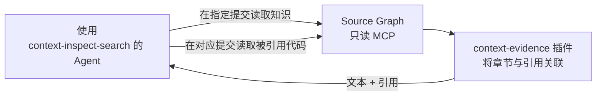

# 远程读取代码证据

<!-- context:section id="goal" -->
基于知识作答时，有时需要查看其背后的代码。把仓库克隆进每个 Agent 沙箱很慢；查询 Skill 可以改为通过只读代码服务 Source Graph，在知识所引用的那个提交上，同时读取 Context 知识工作区和源代码。可选的 **context-evidence** 插件是运行在该服务内部的 WebAssembly 模块，它会把每个知识章节记录的来源引用附加到 Agent 读取的文本上。

> **Source Graph 是可选的。** 你不必安装或配置它。没有该服务时，查询技能照样能很好地工作：它在本地读取代码，对记录的提交做浅层、稀疏的部分克隆，再用 grep 或 rg 搜索。默认的 `auto` 模式只在有可用的已授权实例时才优先使用 Source Graph。
<!-- /context:section -->

<!-- context:section id="enable" -->
## 启用

1. 将你的 Agent 宿主连接到一个只读的 Source Graph MCP 服务，该服务需覆盖知识工作区及其来源仓库。端点和凭据属于宿主配置，绝不放在 Skill 或知识中。
2. 通过 `CONTEXT_QUERY_ACCESS_MODE` 选择访问策略：

| 取值 | 行为 |
| --- | --- |
| `auto`（默认） | 复用合适的本地材料，否则优先使用远程服务，再考虑本地检出 |
| `remote` | 只通过服务读取知识和代码；即使失败也绝不自动克隆 |
| `local` | 仅本地检索；不需要服务 |

明确要求在本地或离线工作时，始终以该要求为准。
<!-- /context:section -->

<!-- context:section id="read" -->
## 读取时发生了什么

- Agent 从配置的知识工作区、在一个固定的提交上读取知识页面，搜索范围限定在 `knowledge/**` 内。
- 启用插件后——在服务支持的情况下，`read` 和 `read_many` 默认开启——每个返回的文件都带有一个 `references:` 列表：即该范围内各章节记录的来源，远端支持时以特定提交的 URL 形式给出。Agent 直接复用这些引用，无需再查询结构和来源登记表。
- 读取代码时，Agent 传入确切的仓库，以记录的完整提交作为 revision，使用相对仓库根目录的路径，并只读取决定答案的那些行范围。
- 知识工作区的提交与每个来源记录的提交分开保存；两者都不会被默认分支替代。
<!-- /context:section -->

<!-- context:section id="limits" -->
## 它不做什么

插件只关联已有的章节标记、`knowledge/structure.yaml` 和来源登记信息。它不校验来源内容、不搜索代码、不恢复来源、也不修改知识；一条引用也不能证明本次查询重新读过该来源。它没有网络、文件系统或进程访问权限；宿主会把每次读取绑定到本次调用的仓库、不可变 revision 和可读范围。

当服务或插件不可用时，Agent 保留可读的文本并继续；在 `auto` 下它可能回退到本地检索，在 `remote` 下则会对受影响的结论加以限定说明，而不是克隆仓库。
<!-- /context:section -->

<!-- context:section id="next" -->
## 运行服务

Source Graph 本身的部署和接入——仓库、monorepo 路径分组、认证与运维——见 Source Graph 相关指南。Context 这一侧无需额外配置：证据插件已编译并随 CLI 一同发布。
<!-- /context:section -->
