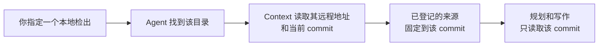

# 代码仓库

<!-- context:section id="goal" -->
已登记的仓库是一个**来源边界**：Agent 在编写知识时可以阅读和引用的代码。登记会把仓库固定到一个 commit，因此每条引用指向的代码都不会在其下发生变动。登记并不决定要写什么；那是之后在 [开工报告](../planning-and-production/start-reports.md) 中决定的。


<!-- /context:section -->

<!-- context:section id="ask" -->
## 告诉 Agent

说明检出目录以及读者需要其中的哪一部分，用自然语言即可：

```text
请把 ../payments-service 作为代码来源。读者需要了解退款流程；
跳过旧的管理模块。
```

如果你的请求已经点名了确切的本地模块，Agent 不会让你重复，也不会要求你提供远程 URL：它会在磁盘上找到每个模块，并从检出中读取仓库的远程地址和当前 commit。只有当名称有歧义、没有匹配项，或选择某个匹配项会扩大你给定的范围时，它才会询问。
<!-- /context:section -->

<!-- context:section id="recorded" -->
## 记录了什么

Context 会记录仓库、你选择的模块以及它读取的 commit。生成页面中的每条引用都指向该 commit，因此读者可以打开某个陈述所依据的确切代码。代码不需要单独的采集步骤：Agent 直接读取固定 commit 下的检出。一起添加的多个仓库和文档共用同一个登记日期。

其背后的选项列在 [CLI 命令](../../product/reference/context/cli-commands.md) 参考中。
<!-- /context:section -->

<!-- context:section id="monorepo" -->
## Monorepo：选择包，而不是整棵树

Context 从不自行依据当前目录、包名或 Git 远程来扩大边界。当 monorepo 中有多个包时，Agent 会展示它们的路径，并询问哪些应成为来源，然后按下文所述分别登记每个选中的包。

请明确选择包；之后再过滤文件无法选中某个包。在索引过时或无关的区域之前先讨论一下（不必要的代码会耗费阅读时间和 token），但不要仅仅因为某个目录名字看起来陈旧就舍弃它。
<!-- /context:section -->

<!-- context:section id="package-scope" -->
## 如何登记一个包

每个选中的包都按它在仓库中的目录登记，因此 Agent 只读取该目录，每条引用也都指向其中的内容。Agent 用以下三种方式之一记录这个目录：

- 指向本地检出中的包目录，由 Context 据此推断仓库、当前提交和目录；
- 指向检出的根目录，并给出相对该根目录的包目录；或
- 只给出仓库的远程地址和要固定的提交，以及包目录，这样在任何人检出之前就可以登记这个包。

该目录始终相对于仓库根目录，`.` 表示整个仓库。Context 会拒绝位于仓库之外的目录。当本地路径已经指向某个包内部时，由这个路径决定范围：如果再指定另一个不同的目录，会被直接拒绝，而不是悄悄选择其中一个。同一仓库的多个包可以共用一个检出。每种方式对应的选项见 [CLI 命令](../../product/reference/context/cli-commands.md) 参考。
<!-- /context:section -->

<!-- context:section id="parsers" -->
## 代码如何被读取

你不需要按仓库配置解析；它是所选 Indexer 的一部分。Indexer 会检查语言、清单文件、入口、路由和契约，然后使用能回答读者问题的最小解析器集合。社区解析器覆盖 TypeScript/JavaScript、Go、Rush monorepo、Thrift、Protobuf、Markdown/MDX、API 契约、样式表和 SQL schema。解析器的结果如何变成页面，参见 [代码抽取](../../architecture/knowledge/code-extraction.md)。
<!-- /context:section -->

<!-- context:section id="clones" -->
## 在另一台机器上的检出

Git 只保存重新找到代码所需的信息（远程地址、固定的 commit 和模块路径），并不保存检出本身。当知识工作区在别处打开、且某个任务需要这份代码时，Agent 会提供三种选择：

1. 指向一个已有的本地检出；
2. 指定一个有边界的目录，让它在其中查找匹配的检出；或
3. 让 Context 把已登记的仓库克隆到知识工作区的临时区域。

克隆始终使用已登记的 commit，因此现有知识保持可复现。在普通模式下，Agent 会在克隆前询问（在 [全托管模式](../planning-and-production/managed-mode-and-review-policy.md) 下，它会在你选定的范围内直接恢复仓库，不询问）；它从不搜索未指定的磁盘根目录，也不会用其他分支或相近的仓库代替。
<!-- /context:section -->

<!-- context:section id="later" -->
## 代码继续演进时

登记会一直保持其 commit，直到你另作决定。用 `context source add repo <日期> --module <名称> --ref <sha>` 移动它只会修改登记：如果现有知识是在旧 commit 上处理的，该命令的 `next` 提示和工作区路由都会指向 `context update --pending`，由它处理新的 commit。要把知识更新到更新的 commit，请提出更新：Agent 会准备新版本，将其与现有页面引用的内容进行比较，并询问哪些页面需要修改。只有在所选修订被批准、产出重新构建之后，知识才会前移到新的 commit。参见 [更新知识](../updates-and-versions/updating-knowledge.md)。
<!-- /context:section -->
