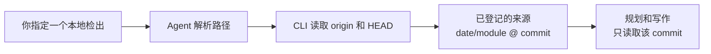

# 代码仓库

<!-- context:section id="goal" -->
已登记的仓库是一个**来源边界**：Agent 在编写知识时可以阅读和引用的代码。登记会把仓库固定到一个 commit，因此每条引用指向的代码都不会在其下发生变动。登记并不决定要写什么；那是之后在开工报告中决定的。


<!-- /context:section -->

<!-- context:section id="ask" -->
## 告诉 Agent

说明检出目录以及读者需要其中的哪一部分，用自然语言即可：

```text
请把 ../payments-service 作为代码来源。读者需要了解退款流程，旧的管理模块就不纳入了。
```

如果你的请求已经点名了确切的本地模块，Agent 不会让你重复，也不会要求你提供远程 URL：它会把每个名称解析到一个本地目录，并让 CLI 读取该检出的 Git 根目录、`origin` 和当前 commit。只有当名称有歧义、没有匹配项，或选择某个匹配项会扩大你给定的范围时，它才会询问。
<!-- /context:section -->

<!-- context:section id="recorded" -->
## 记录了什么

Agent 会用类似下面的命令登记模块：

```bash
context source add repo 20261012 --module payments-service --local ../payments-service --configure
```

| 选项 | 含义 |
| --- | --- |
| `20261012` | 采集批次日期。多个仓库和文档可以共用同一个日期。 |
| `--module` | 必填。具体的仓库或包名。 |
| `--local` | 本地检出路径；可以指向 monorepo 的子目录。 |
| `--remote` / `--ref` | 远程 URL 和固定的 commit。省略时从本地 `origin` 和 `HEAD` 推断。 |
| `--configure` | 同时在简单的 `src/index.ts` 中选中该来源。它从不执行任何采集。 |

来源以 `date/module` 的形式寻址，例如 `20261012/payments-service`。这个名称会出现在来源引用中；稳定的代码知识路径使用不带日期的模块名。代码来源不需要采集阶段：Agent 直接读取固定 commit 下的检出。
<!-- /context:section -->

<!-- context:section id="monorepo" -->
## Monorepo：选择包，而不是整棵树

Context 从不依据当前目录、包名或 Git 远程来扩大边界。当 monorepo 中有多个包边界时，Agent 会展示它们的路径，并询问哪些应成为来源。把 `--local` 分别指向每个选中的包。

在来源内部过滤文件无法选中 monorepo 的包，因此请明确选择包。在索引过时或无关的区域之前先讨论一下——不必要的代码会耗费阅读时间和 token——但不要仅仅因为某个目录名字看起来陈旧就舍弃它。
<!-- /context:section -->

<!-- context:section id="parsers" -->
## 代码如何被读取

解析是所选 Indexer 的细节，不需要你按仓库配置。Indexer 会检查语言、清单文件、入口、路由和契约，然后使用能回答读者问题的最小解析器集合。社区解析器覆盖 TypeScript/JavaScript、Go、Rush monorepo、Thrift、Protobuf、Markdown/MDX、API 契约、样式表和 SQL schema。解析器产出的事实如何变成页面，参见[代码抽取](../../architecture/knowledge/code-extraction.md)。
<!-- /context:section -->

<!-- context:section id="clones" -->
## 在另一台机器上的检出

Git 只为仓库来源保存恢复配方：远程地址、固定的 commit 和模块路径，并不保存检出本身。当 Context 知识工作区在别处打开、且某个任务需要这份代码时，Agent 会提供三种选择：

1. 指向一个已有的本地检出；
2. 指定一个有边界的目录，让它在其中扫描匹配的检出；或
3. 允许 Context 把已登记的仓库克隆到 `.tmp/repo/`。

恢复克隆始终使用已登记的 commit，因此现有知识保持可复现。在普通模式下，Agent 会在克隆前询问；它从不扫描未指定的磁盘根目录，也不会用其他分支或相近的仓库代替。
<!-- /context:section -->

<!-- context:section id="later" -->
## 代码继续演进时

登记会一直保持其 commit，直到你另作决定。要把知识更新到更新的 commit，请提出更新：Agent 会准备新版本，将其与现有页面引用的内容进行比较，并询问哪些页面需要修改。只有在所选修订被批准并构建之后，已处理的基线才会前移。参见[更新知识](../updates-and-versions/updating-knowledge.md)。
<!-- /context:section -->
