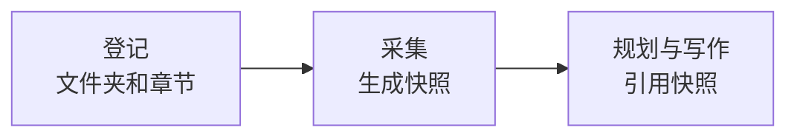

# 文档目录

<!-- context:section id="goal" -->
当材料是本地 Markdown 时，使用文档来源：一个文件、多个文件或一个文档文件夹都可以。与代码仓库不同，文档来源需要**采集**：Context 会生成可复现的快照，页面引用的是该快照，而不是实时变化的文件夹。


<!-- /context:section -->

<!-- context:section id="ask" -->
## 告诉 Agent

说明要导入哪些文档，而不只是你当前所在的文件夹：

```text
请将 ../docs/user-guide 作为产品文档导入，只需要 getting-started 和 billing 章节。
```

你交给 Agent 的运行说明、手册、计划或任务清单都会被视为任务指引，而不是来源，除非你明确要求导入它们。如果要采集哪些文档并不明确，Agent 会询问一次，而不是把你的指引采集进去。
<!-- /context:section -->

<!-- context:section id="register" -->
## Agent 会确认什么

登记时还不读取任何内容。Agent 会记录你指定的文件夹或文件；如果你限定了范围，则只记录你要求的章节或模式——在上面的例子中是 `getting-started` 和 `billing`。随后它为该来源做好采集准备，并告诉你登记了什么。

如果知识工作区已有自定义的来源设置，Agent 会做针对性修改以加入新文件夹，并告诉你改了什么。完整的登记选项参见 [CLI 命令](../../product/reference/context/cli-commands.md)参考。
<!-- /context:section -->

<!-- context:section id="capture" -->
## 采集

采集会读取文档，因此需要你在当前对话中授权。要求采集、导入或读取指定文档即视为授权；仅仅提到这些文档或只要求登记则不算，这种情况下 Agent 会先询问你。之后 Agent 会采集文档、报告结果，并持续执行直到请求中的所有文档都完成。

采集只生成快照，不做分类、摘要或批准。Context 会保持快照完整，Agent 绝不手动编辑它。
<!-- /context:section -->

<!-- context:section id="sites" -->
## 文档站

采集默认读取普通 Markdown。如果该文件夹实际上是一个文档站——包含 MDX 页面、侧边栏或站点配置——Agent 会告诉你，并在修改读取方式之前先征求你的同意。路由元数据和静态组件文本会作为证据保留。

如果某个页面只是在运行时加载内容的外壳，Agent 会告诉你，并请你提供渲染后的站点或其数据源，而不是凭空编造正文。
<!-- /context:section -->

<!-- context:section id="later" -->
## 文档发生变化时

页面会继续引用其写作时依据的快照。文件夹内容变化后，请发起更新：Agent 会采集新版本，并询问哪些页面需要修改。参见[更新知识](../updates-and-versions/updating-knowledge.md)。
<!-- /context:section -->
