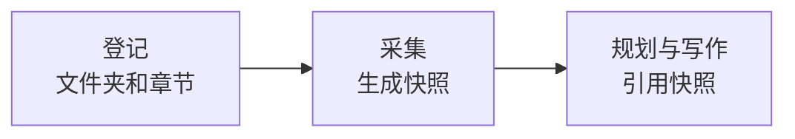

# 文档目录

<!-- context:section id="goal" -->
资料是本地 Markdown 时，就用文档来源：一个文件、几个文件或整个文档文件夹都可以。和代码仓库不同，文档来源需要先**采集**：Context 会生成一份可复现的快照，页面引用的是这份快照，而不是随时在变的文件夹。


<!-- /context:section -->

<!-- context:section id="ask" -->
## 告诉 Agent

说清楚要导入哪些文档，而不只是说当前所在的文件夹：

```text
请把 ../docs/user-guide 作为产品文档导入，只需要 getting-started 和 billing 两个章节。
```

你交给 Agent 的运行说明、手册、计划或任务清单，默认都当作任务指引，而不是来源；只有你明确要求导入时才会登记。如果不确定要采集哪些文档，Agent 会先问你一次，而不会把你的指引当成资料采集进去。
<!-- /context:section -->

<!-- context:section id="register" -->
## Agent 会确认什么

登记时还不会读取任何内容。Agent 会记下你指定的文件夹或文件；如果你限定了范围，就只记下你要的章节或匹配规则，比如上例中的 `getting-started` 和 `billing`。然后它为这个来源做好采集准备，并告诉你登记了哪些内容。

有两项设置会影响快照，要在页面开始引用这个来源之前定好：

- **保留文件夹结构**：默认情况下，文档来源只保留文件名。如果文件夹本身有含义，比如 `guides/` 和 `reference/` 下都有 `setup.md`，就请 Agent 保留文件夹结构；快照会保留文件夹，以及文档链接到的图片和小型数据文件。
- **把结构化文件当作文档**：默认只读取 Markdown。如果页面需要把小型 JSON 或 YAML 文件当作文本引用，请说明这些扩展名，它们也会作为文档采集。图片只作为资源保留，不作为引用对象。

之后再改这两项设置，快照里的路径会随之变化，引用这个来源的页面就要像处理文件改名一样跟着调整。

如果知识工作区已经自定义过来源设置，Agent 会只做必要的修改来加入新文件夹，并告诉你改了哪些地方。完整的登记选项见 [CLI 命令](../../product/reference/context/cli-commands.md)参考。
<!-- /context:section -->

<!-- context:section id="capture" -->
## 采集

采集会读取文档内容，所以需要你在当前对话中授权。你要求采集、导入或读取指定文档，就算授权；只是提到这些文档，或只要求登记，都不算，这时 Agent 会先问你。授权后，Agent 会采集文档、报告结果，一直做到请求中的文档全部完成。

链接的图片缺失、位于来源之外、与其他文件冲突或超过 5 MB 时，采集不会中断：链接保持原样，Agent 会把它报告为资源缺口，你可以修正原文，也可以接受这个缺口。

采集只生成快照，不做分类、摘要或审批。Context 会保证快照完整，Agent 也不会手动修改快照。
<!-- /context:section -->

<!-- context:section id="sites" -->
## 文档站

采集默认读取普通 Markdown。如果这个文件夹其实是一个文档站（包含 MDX 页面、侧边栏或站点配置），Agent 会告诉你，并在改变读取方式之前先征得你的同意。路由元数据和静态组件里的文字会作为依据保留下来。

如果某个页面只是运行时才加载内容的空壳，Agent 会告诉你，并请你提供渲染后的站点或它的数据源，而不会凭空编造正文。
<!-- /context:section -->

<!-- context:section id="later" -->
## 文档发生变化时

页面会继续引用写作时依据的那份快照。文件夹内容变了以后，请发起更新：Agent 会采集新版本，并和你确认哪些页面需要修改。参见[更新知识](../updates-and-versions/updating-knowledge.md)。

如果这些文档由其他团队按版本发布（比如文档仓库或已发布的知识包），或者文件夹即将归档，参见[按版本发布与即将归档的资料](versioned-external-content.md)。
<!-- /context:section -->
