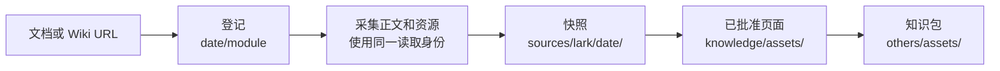

# 飞书文档

<!-- context:section id="goal" -->
飞书来源是一份远程文档，Context 会把它连同其中嵌入的证据一起采集为本地快照：图片、附件、电子表格、多维表格（Base）、画板和同步块。页面随后引用该快照。Agent 从不重建资源的原始字节，也不会用摘要代替它们；资源由采集流程机械地处理。


<!-- /context:section -->

<!-- context:section id="register" -->
## 登记文档

直接传入文档或 Wiki URL；采集时会连同正文一起获取标题，无需单独查询：

```bash
context source add lark 20261012 --module handbook \
  --url https://example.larkoffice.com/wiki/example-token --configure
```

`--doc-token` 和 `--wiki-token` 可以用身份 token 代替 URL，`--title` 用于记录你已知的标题。所有被要求的文档都登记在同一个日期下。对于设置相同的多份文档，Agent 会基于来源登记表声明一次采集，而不是为每份文档重复一个阶段；文档相互独立并不意味着文章也要相互独立。

对于整个 Wiki 子树，Agent 可以先运行 `context source discover lark <url>`，保存目录树和页面标识而不读取正文，以便你选择要登记哪些页面。
<!-- /context:section -->

<!-- context:section id="identity" -->
## 读取身份

采集使用**同一个**身份读取正文和所有资源。`CONTEXT_LARK_IDENTITY=user|bot` 用于选择身份，默认为 `user`。请在每个运行 Context 命令的 shell 中导出它；写在 Bot 提示词里的设置并不是环境变量。

- **User** 只以当前用户身份读取。
- **Bot** 在读取正文因凭证、权限范围或访问权限失败时，可以回退一次到当前用户。回退会重新读取整篇正文，因此绝不会把两个身份读到的页面拼在一起。

正文一旦读取完成，所有资源都使用该身份。资源读取失败从不会去索要其他身份的凭证，网络、限流和格式错误也不会切换身份。
<!-- /context:section -->

<!-- context:section id="resources" -->
## 嵌入资源如何处理

| 资源 | 采集结果 |
| --- | --- |
| 图片 | 原图；若下载被拒绝，则使用同一身份获取一张预览图，并标记为预览 |
| 附件 | 原始文件，从 Markdown 中链接 |
| 电子表格 | 一张 Markdown 表格加一份 CSV 快照 |
| 多维表格（Base） | 选定的数据表或视图，输出为 Markdown 表格加一份 JSON 快照 |
| 画板、图表 | 一张可读的预览图加原始结构化导出 |
| 同步块 | 源块的正文加一份 Markdown 证据快照 |
| 书签、子文档、群聊、嵌入内容 | 一个稳定的导航引用 |
| 视频 | 一个引用；仅在设置 `resources.videos: "bundle"` 时下载 |

无法获取必需的资源时，采集会停止。有两种情况会被记录并带警告继续：API 确认已被删除的画板或图表，以及某个嵌入资源被明确拒绝访问。两者都会留下可见的“资源不可用”提示，且都不会被报告为已下载。
<!-- /context:section -->

<!-- context:section id="images" -->
## 大型任务的图片选择

一个任务的图片处理方式只决定一次，而不是逐个文档决定。任务指令 `DOCUMENT_IMAGE_CAPTURE` 接受 `ON`（包含图片）、`OFF`（仅引用）或一个文档数量阈值，默认为 `10`：超过该阈值时，正文只采集图片引用。当一个任务在没有策略的情况下将获取 30 张以上不同的图片时，开工报告会请你在以下选项中选择：智能转换并纳入（推荐）、包含全部图片，或仅保留占位符。

如果要在项目中固定这一选择：

```ts
captureLark({ source: handbook, resources: { images: "reference-only" } });
captureLark({ source: handbook, resources: { gifs: "reference-only" } });
```
<!-- /context:section -->

<!-- context:section id="storage" -->
## 文件存放位置

```text
sources/lark/<date>/
├── <module>.md               # 采集的正文
├── manifest.json             # 含哈希值的精简清单
└── assets/<module>/
    ├── source.xml            # 结构化原文
    ├── capture-report.json   # 内容保真和资源处理情况
    └── materialized/**       # 下载的文件和导出内容
knowledge/assets/<kind>/<sha256>.<ext>   # 仅保留已审核页面使用的资源
```

来源资产是证据快照的一部分，因此请把它们保留在 Git 中；二进制文件较多的仓库可以把 `materialized/` 存放在 Git LFS 中。当文档或截图有访问控制时，请将 Context 知识工作区设为私有。
<!-- /context:section -->

<!-- context:section id="prefetched" -->
## 复用已有的抓取结果

如果调研阶段已经抓取过某份文档，`context source fetch lark <url> --output <dir>` 可以在任何知识工作区存在之前保存一份可移植的快照。登记对应的来源后，使用带 `snapshot_dir` 的 `context source import` 即可导入，无需再次读取文档。导入会检查完整性并保留原始采集时间；它不会让快照变得更新。
<!-- /context:section -->
