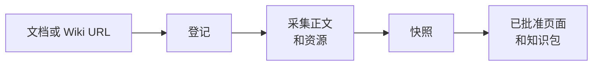

# 飞书文档

<!-- context:section id="goal" -->
飞书来源是一份远程文档，Context 会把它连同其中嵌入的证据一起采集为本地快照：图片、附件、电子表格、多维表格（Base）、画板和同步块。页面随后引用该快照。Agent 从不重建资源，也不会用摘要代替它们；资源由采集流程按原样处理。


<!-- /context:section -->

<!-- context:section id="register" -->
## 添加文档

把文档或 Wiki URL 交给 Agent 即可；标题会连同正文一起获取，无需你另行查询：

```text
把这个 Wiki 页面作为我们的运维手册导入：
https://example.larkoffice.com/wiki/example-token
```

在一次请求中提到的多份文档会一起添加，而且文档相互独立并不意味着文章也要相互独立。对于整个 Wiki 子树，Agent 可以先列出目录树及其页面而不读取正文，以便你选择要添加哪些页面。

如果调研阶段已经抓取过某份文档，Agent 可以复用那份副本而不必再次读取；复用会保留原始采集时间，因此不会让内容变得更新。详情参见 [CLI 命令](../../product/reference/context/cli-commands.md) 参考。
<!-- /context:section -->

<!-- context:section id="large-wiki-trees" -->
## 超大的 Wiki 树

不要指望一次性生产完一棵大型 Wiki 树：来源文档超过 30 份时，Agent 会分阶段规划工作；范围非常大时，它会先与你确认或缩小范围，详见 [分阶段规划大型项目](../planning-and-production/planning-large-projects.md)。
<!-- /context:section -->

<!-- context:section id="authorization" -->
## 读取授权

采集会读取文档，因此需要你在当前对话中授权。让 Agent 采集、导入或读取指定的文档即构成授权；仅仅提到某份文档，或只要求登记它，都不构成授权，这种情况下 Agent 会在采集前先询问你。
<!-- /context:section -->

<!-- context:section id="identity" -->
## 读取身份

每份文档连同其所有资源都以**同一个**身份读取：默认是你本人，也可以是某个 Bot。这一选择由运行 Context 的环境中的 `CONTEXT_LARK_IDENTITY` 设置（`user` 或 `bot`）决定；写在 Bot 提示词里的一行文字不会改变它。

- **以你的身份**读取时，Context 只以你的身份读取。
- **以 Bot 身份**读取时，如果 Bot 无法读取正文，Context 可以回退一次，改以你的身份读取。回退会让整篇文档重新开始读取，因此绝不会把两个身份读到的内容拼成一个页面。

正文一旦读取完成，所有资源都使用同一身份。图片或电子表格读取失败从不会去索要其他人的凭证，网络、限流或格式错误也不会切换身份。
<!-- /context:section -->

<!-- context:section id="resources" -->
## 嵌入资源如何处理

| 资源 | 采集结果 |
| --- | --- |
| 图片 | 原图；若下载被拒绝，则获取一张预览图，并标记为预览 |
| 附件 | 原始文件，从文档中链接 |
| 电子表格 | 一张 Markdown 表格加一份 CSV 快照 |
| 多维表格（Base） | 选定的数据表或视图，输出为 Markdown 表格加一份数据快照 |
| 画板、图表 | 一张可读的预览图加原始结构化导出 |
| 同步块 | 源块的正文 |
| 书签、子文档、群聊、嵌入内容 | 一个稳定的导航引用 |
| 视频 | 一个引用；仅在你要求打包视频时下载 |

无法获取必需的资源时，采集会停止。有两种情况会被记录并带警告继续：飞书确认已被删除的画板或图表，以及某个嵌入资源被明确拒绝访问。两者都会留下可见的“资源不可用”提示，且都不会被报告为已下载。

采集到的资源是证据的一部分，会随知识工作区一起保存在 Git 中，因此当文档或截图有访问控制时，请将知识工作区设为私有。
<!-- /context:section -->

<!-- context:section id="images" -->
## 大型任务的图片选择

一个任务的图片处理方式只决定一次，而不是逐个文档决定。你可以让 Agent 包含图片、只保留图片引用，或根据任务涉及的文档数量自动切换。默认的切换点是 10 份文档：不超过 10 份时包含图片；超过时，文档只采集图片引用。

图片数量则单独考量。当一个任务将引入 30 张以上不同的图片、而你尚未做出选择时，[开工报告](../planning-and-production/start-reports.md) 会请你在以下选项中选择：智能转换并纳入（推荐）、包含全部图片，或仅保留占位符。

如果希望同一选择适用于某个知识工作区中的每个任务，请让 Agent 为项目设置它，例如“手册只保留图片和 GIF 的引用”。
<!-- /context:section -->
