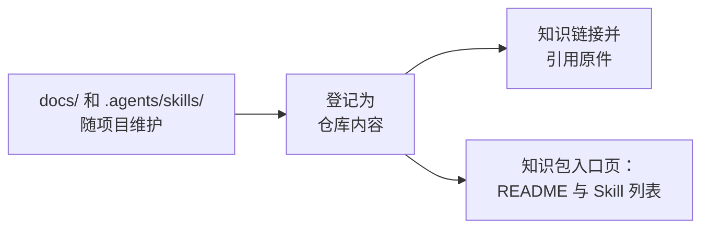

# 链接已有的文档与 Skill

<!-- context:section id="goal" -->
很多项目已经把文档和 Agent Skill 放在代码旁边，例如 `docs/` 和 `.agents/skills/` 下，并随每次改动一起更新。当知识工作区位于同一个 Git 仓库中时，没有必要把这些材料再生产一遍知识。把它们登记为**仓库内容**即可：原件留在原处，随项目持续演进；Context 直接引用它们——知识链接到它们，也可以把它们作为证据引用——而不复制正文。


<!-- /context:section -->

<!-- context:section id="boundaries" -->
## 何时改用其他方式

- **其他仓库或外部安装的 Skill** 不属于仓库内容，请将它们声明为 [外部入口](external-entrances.md)。
- **为特定读者改写选定的文档**属于普通生产：把这些文档登记为 [文档来源](document-directories.md)，由 Agent 撰写、你来审核页面。仓库内容从不会被整体镜像到知识中。
<!-- /context:section -->

<!-- context:section id="register" -->
## 登记

在 Agent 中这样请求：

```text
/c4a:context-repo-content 把 docs/ 和 .agents/skills 登记为仓库内容。
```

在 Cursor 中使用 `/c4a-context-repo-content`。`context-repo-content` Skill 只查看项目中纳入版本管理的 README、`docs/` 和 Skill 目录。它会提议有用的目录，而不是逐个列出 Markdown 文件；会跳过安装的第三方 Skill；并把你的选择记录到知识工作区中。之后在已登记目录中新增的文件无需重新登记。登记不会启动生产、更新知识、构建、发布或提交。同一个 Skill 也可以在原位置创建或编辑这些项目文档。
<!-- /context:section -->

<!-- context:section id="cite" -->
## 知识如何使用它

- **链接。** 页面可以链接到原件。构建时，如果代码仓库中有对应文件的地址，就把链接转换为指向该文件的链接，否则转换为普通位置。
- **证据。** 页面可以像引用其他来源一样引用原件。引用会记录所读取的提交、路径和行范围；尚未提交的文本会被标注出来。
- **生产。** 文档 Indexer 把已登记的内容作为有边界的辅助证据来阅读；不会把它变成一套平行的页面。
<!-- /context:section -->

<!-- context:section id="page" -->
## 知识包和站点包含什么

知识包不包含已登记的文档或 Skill 脚本。它可以带一个入口页（使用分组时每组一页），其中包括：

- 该分组的 README，其中的相对链接会改写为仓库的网页地址；
- 已登记 Skill 的表格，包含名称、描述和指向原件的链接。

已有仓库内容登记的新知识工作区会把这个页面放进知识包。如果你也想在网站上展示它，请告诉 Agent，并在公开之前先审阅 README。

在同一仓库中工作的 Agent 直接阅读原件。在其他地方安装知识包的人和 Agent 看到的是入口页及其链接，需要有仓库访问权限才能阅读全文。
<!-- /context:section -->

<!-- context:section id="updates" -->
## 原件变化时

原件随项目持续演进，编辑它们本身从不会启动知识更新。当链接或引用它们的页面可能受影响时，请让 `/c4a:context` 检查已变化的仓库内容带来的影响。更新会比较文档中被引用的区域和每个 Skill 的整个目录，并只重新打开受影响的小节。
<!-- /context:section -->

<!-- context:section id="registry" -->
## 登记保存在哪里

Skill 把登记保存在知识工作区根目录的 `repo-content.yaml` 中，路径相对于 Git 根目录；你可以让它为条目分组，或跳过某个条目内的文件。它旁边的 `repo-content/` 是原件的视图，不是第二个编辑位置；请编辑原件。这些文件在工作区其他文件中的位置见 [Context 知识工作区](../../product/getting-started/knowledge-workspace.md)；该 Skill 做什么、不做什么，列在 [技能清单](../../product/reference/context/skills.md)参考中。
<!-- /context:section -->

<!-- context:section id="fix" -->
## 出现问题时

- 如果登记无效，Agent 检查工作区时会报告，构建会在替换现有产出之前停止。请让 Agent 修正登记，而不是再次修复视图。
- 只有在视图缺失或指向错误位置时，才会建议修复它。

登记仓库内容并不代表授权安装、运行或发布任何内容。
<!-- /context:section -->
