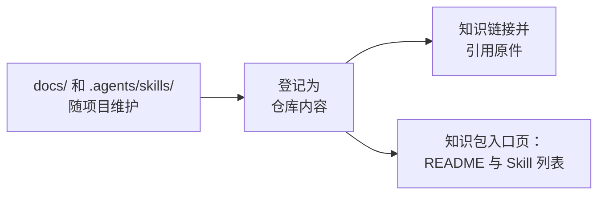

# 引用同仓库的文档与 Skill

<!-- context:section id="goal" -->
很多项目已经把文档和 Agent Skill 放在代码旁边，例如 `docs/` 和 `.agents/skills/` 下，并随每次改动一起更新。当 Context 知识工作区位于同一个 Git 仓库中时，没有必要把这些材料再生产一遍知识。把它们登记为**仓库内容**即可：原件留在原处，随项目持续演进；Context 直接引用它们——知识链接到它们，也可以把它们作为证据引用——而不复制正文。


<!-- /context:section -->

<!-- context:section id="boundaries" -->
## 何时改用其他方式

- **其他仓库或外部安装的 Skill** 不属于仓库内容，请将它们声明为[外部入口](external-entrances.md)。
- **为特定读者改写选定的文档**属于普通生产：把这些文档登记为文档来源，由工作流生产并审核页面。仓库内容从不会把整个登记表镜像到知识中。
<!-- /context:section -->

<!-- context:section id="register" -->
## 登记

在 Agent 中这样请求：

```text
/c4a:context-repo-content 把 docs/ 和 .agents/skills 登记为仓库内容。
```

`context-repo-content` Skill 只查看项目中纳入版本管理的 README、`docs/` 和 Skill 目录。它会提议有用的目录，而不是逐个列出 Markdown 文件；会跳过安装的第三方 Skill；并把选择记录到知识工作区根目录的 `repo-content.yaml` 中。之后在已登记目录中新增的文件无需新增条目。登记不会启动生产、更新知识、构建、发布或提交。同一个 Skill 也可以在原位置创建或编辑这些项目文档。
<!-- /context:section -->

<!-- context:section id="cite" -->
## 知识如何使用它

- **链接。** 页面用 `[Guide](context:repo/docs/guide.md)` 链接到原件。构建时，如果代码仓库中有对应文件的地址，就转换为指向它的链接，否则转换为普通位置。
- **证据。** 页面可以像引用其他来源一样引用原件。引用会记录 `repo-content:docs@<commit>`，以及真实路径、行范围和摘要值；未提交的文本记录为 `<commit>+worktree`。
- **生产。** 文档 Indexer 把已登记的内容作为有边界的辅助证据来阅读；不会把它变成一套平行的页面。
<!-- /context:section -->

<!-- context:section id="page" -->
## 知识包和站点包含什么

知识包不包含已登记的文档或 Skill 脚本。它可以带一个入口页 `wikis/repo-content.md`（使用分组时每组一页），其中包括：

- 该分组的 README，其中的相对链接会改写为仓库的网页地址；
- 已登记 Skill 的表格，包含名称、描述和指向原件的链接。

已有登记表的新知识工作区会启用这个页面；`src/index.ts` 中的知识包声明带有 `repoContentPage: true`。只有声明为 `repoContentPage: { site: true }` 时，网站才会展示它。公开之前请先审阅 README。

在同一仓库中工作的 Agent 直接阅读原件。在其他地方安装知识包的人和 Agent 看到的是入口页及其链接，需要有仓库访问权限才能阅读全文。
<!-- /context:section -->

<!-- context:section id="updates" -->
## 原件变化时

原件随项目持续演进，编辑它们本身从不会启动知识更新。当链接或引用它们的页面可能受影响时，请让 `/c4a:context` 检查已变化的仓库内容带来的影响。更新会比较文档中被引用的区域和每个 Skill 的整个目录，并只重新打开受影响的小节。
<!-- /context:section -->

<!-- context:section id="registry" -->
## 登记文件

`repo-content.yaml` 由 Skill 替你写入，形式如下：

```yaml
protocol: context.repo-content/v1
entries:
  docs:
    kind: docs
    path: docs
  tools:
    kind: skills
    path: .agents/skills
```

路径相对于 Git 根目录，而不是知识工作区。可用的类型有 `docs`、`document`、`skills` 和 `skill`。可选的 `group` 会增加一层模块层级，`mount` 用于覆盖默认挂载名，`exclude` 通配符用于跳过条目内的文件（它们不是访问控制）。重叠的条目、指向仓库外的目标、嵌套仓库和循环都会被拒绝。`repo-content/` 目录存放指向原件的相对符号链接；它只是一个视图，不是第二个编辑位置。
<!-- /context:section -->

<!-- context:section id="fix" -->
## 出现问题时

- `status` 会报告无效的 `repo-content.yaml`，构建会在替换现有产物之前停止。请修正该文件，而不是再次修复符号链接。
- 只有在符号链接缺失或指向错误时，才会建议修复它们。

登记仓库内容并不代表授权安装、运行或发布任何内容。
<!-- /context:section -->
