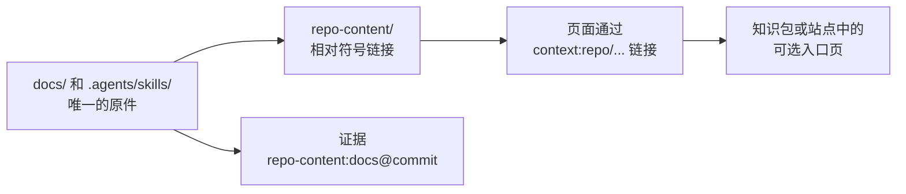

# 同仓库文档

<!-- context:section id="goal" -->
当 Context 知识工作区位于某个项目仓库内部时，该仓库通常已经有文档和 Agent Skill。它们应该留在原处，并继续在原处编辑。`repo-content.yaml` 把它们登记为**同仓库内容**：Context 链接到原件，而不是把正文复制到知识或来源快照中。



使用 `context-repo-content` Skill 来选择和编辑这些条目；它不会启动知识生产。
<!-- /context:section -->

<!-- context:section id="register" -->
## 登记

在知识工作区根目录下：

```yaml
protocol: context.repo-content/v1
entries:
  docs:
    kind: docs
    path: docs
  tools:
    kind: skills
    path: .agents/skills
```

路径相对于 Git 根目录，而不是知识工作区。可用的类型有 `docs`、`document`、`skills` 和 `skill`。可选的 `group` 会增加一层模块层级，`mount` 用于覆盖默认挂载名，`exclude` 通配符用于跳过条目内的文件（它们不是访问控制）。重叠的条目、指向仓库外的目标、嵌套仓库和循环都会被拒绝。

`context source ensure repo-content --format json` 负责维护 `repo-content/` 下的相对符号链接；`context status` 只报告问题，不做修复。普通文件永远不会被覆盖，Git 配置和索引也不会被修改。
<!-- /context:section -->

<!-- context:section id="cite" -->
## 链接与引用

页面用 `[Guide](context:repo/docs/guide.md)` 链接到原件；构建时，如果有上游链接就转换为上游链接，否则转换为普通位置。证据会记录 `repo-content:docs@<full-commit>`，以及真实路径、行范围和摘要值；未提交的文本记录为 `<commit>+worktree`。
<!-- /context:section -->

<!-- context:section id="page" -->
## 可选入口页

```ts
kbPackage({ name: "project-kb", template: { path: "src/package-templates/kb" }, repoContentPage: true });
```

这会把每个分组的 README 以及 Skill 的名称和描述投影到 `wikis/repo-content.md`；它不会复制全部文档或 Skill 脚本。`{ site: true }` 会把该入口加入已配置的网站。在公开 README 之前，请先评估其敏感性。
<!-- /context:section -->

<!-- context:section id="fix" -->
## 出现问题时

- `status` 会报告无效的 `repo-content.yaml`，`context build` 会在替换现有产物之前停止。请修正该文件，而不是重新运行 `ensure`。
- 只有在符号链接缺失或指向错误时，才会建议运行 `ensure`。
- 其他仓库和外部安装的 Skill 不属于同仓库内容；请将它们声明为[外部入口](external-entrances.md)。

登记入口并不代表授权安装、运行或发布任何内容。
<!-- /context:section -->
