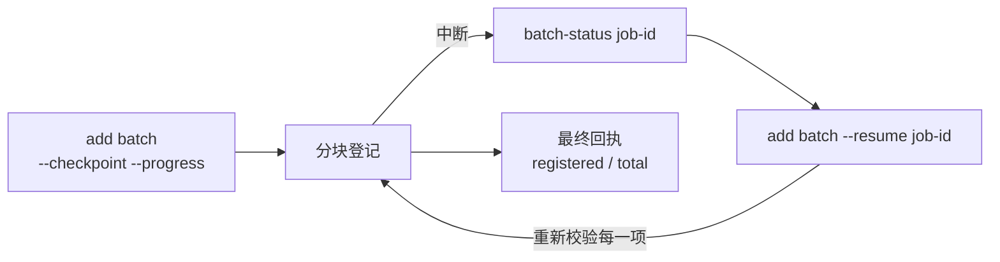

# 来源批次

<!-- context:section id="goal" -->
当任务涉及大量来源——十几个服务、一个装满手册的文件夹、一个 Wiki 分区——请把它们作为一个批次登记，而不是一条命令登记一个。一个批次是同一日期下的一次串行登记写入，来源之间不会相互竞争；配合检查点，耗时较长的登记即使中断也能继续。

登记大量来源并不等同于生产一个大型知识库。如果工作涉及超过 30 份文档，或需要对两个及以上仓库做实质性调研，Agent 会先把项目分阶段规划；参见[大型项目](../../product/getting-started/large-projects.md)。
<!-- /context:section -->

<!-- context:section id="payload" -->
## 输入内容

```yaml
sources:
  - type: repo
    module: billing-service
    local: ../billing-service
  - type: file
    local: ../docs/user-guide.md
  - type: lark
    url: https://example.larkoffice.com/wiki/example-token
```

```bash
context source add batch 20261012 --input .tmp/sources.yaml --configure --format json
```

- `repo.module` 为必填；`file` 和 `lark` 的模块名省略时会根据路径或 URL 推导，批次内的重复项会被拒绝。
- `repo.local` 相对于 Context 项目根目录解析。有效的检出目录会提供其远端和提交，因此只有在无法读取时才需要填写 `remote`/`ref`。
- `--configure` 还会在简单的 `src/index.ts` 中声明这些来源和默认的采集阶段。不加该选项时，批次只做登记。
<!-- /context:section -->

<!-- context:section id="checkpoint" -->
## 长批次：检查点与恢复



```bash
context source add batch 20261012 --input .tmp/sources.yaml --checkpoint --progress --format json
context source batch-status <job-id> --format json
context source add batch --resume <job-id> --progress --format json
```

保存的输入位于 `.tmp/context-runtime/source-batches/` 下，因此恢复时不需要原始文件。恢复会针对当前登记表重放并重新校验每一项；保存的游标只是参考。不要把 `--resume` 与日期或新的输入一起使用。进度以有界 JSON 输出到 stderr；stdout 保留最终回执。
<!-- /context:section -->

<!-- context:section id="failure" -->
## 部分失败与锁

批次会保留已成功的部分：失败项之前的条目保持已登记状态，错误信息会列出已完成的条目和失败的位置。飞书条目在内存中校验，并按有界的原子分块提交。

一个 Context 知识工作区同一时间只运行一个写入者。请等待正在运行的命令结束，不要另起一个命令或删除它的锁。如果强制停止留下了失效的锁，请先运行 `context task recover --format json`，再恢复执行。
<!-- /context:section -->
