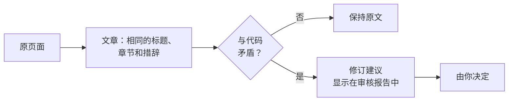

# 保持页面原文

<!-- context:section id="goal" -->
有时页面必须保持原有措辞：团队依赖的值班流程、一项政策、仍由作者负责的运行手册。你仍然希望它们进入你的知识库——放在你的分区里、进入你的知识包，并与它们所描述的代码核对。把需求标记为**保持原文**正好可以做到：每个页面带着原有的标题、章节、顺序和措辞进来，只有与代码矛盾的段落才会被提出修订，由你决定。


<!-- /context:section -->

<!-- context:section id="ask" -->
## 提出请求

先把资料集登记为[文档来源](../registering-sources/document-directories.md)——保留它的文件夹；如果它仍在变化，就以其仓库和版本作为来源；参见[按版本发布与即将归档的资料](../registering-sources/versioned-external-content.md)。然后提出：

```text
把运维 wiki 里的值班页面原样接入。保留标题、章节和措辞；
用订单服务和计费服务的代码核对它们。
```

Agent 会把这一点记录在需求上（`preserve_original: true`），并把这些页面所描述的仓库列为它的辅助来源，让写作者可以引用和核对这些代码。缺少它们时，文章只能引用原页面，也就无法发现矛盾。
<!-- /context:section -->

<!-- context:section id="writing" -->
## 写作者做什么

每个原页面成为一篇文章，标题、章节标题、内容顺序和措辞都相同。每个章节都引用它所复现的原文行，以及段落所描述的代码。代码没有否定的措辞、风格或结构保持不变。

当某个段落与代码矛盾，或描述了代码已不再具有的行为时，写作者把更正后的文字写进文章，并提出修订建议。Context 会自己读取原文段落，因此建议准确显示原来写的是什么。每条建议都会说明原文是一开始就**写错**，还是因为代码之后变化而**过时**，并指出它所依据的代码。
<!-- /context:section -->

<!-- context:section id="decide" -->
## 在审核报告中做决定

[审核报告](reading-review-reports.md)把修订建议显示在文章上方：原文段落、修订后的文字、原因和证据。对每一条你可以选择：

| 选择 | 文章 | 原资料 |
| --- | --- | --- |
| 接受，并同时修正原资料 | 保留修订 | 向页面负责人提出更正；参见[回写上游](../updates-and-versions/writing-back-upstream.md) |
| 只在这里修订 | 保留修订 | 不变 |
| 保留原文 | 恢复原文段落，仍引用代码 | 不变 |

Agent 把你的选择应用到文章，记入本批次的 changelog 条目，并移除该建议。建议只在批次审核期间存在；之后由文章、它的 changelog 和 Git 历史承载这个决定。

在[全托管](../planning-and-production/managed-mode-and-review-policy.md)运行或[例行更新](../updates-and-versions/scheduled-updates.md)中，Agent 只在知识库中修订，并在报告中列出每条修订，你之后随时可以改变其中任何一条。
<!-- /context:section -->

<!-- context:section id="later" -->
## 之后代码变化时

由于每个保持原文的段落仍引用它的代码，之后的代码变化会通过普通的[更新流程](../updates-and-versions/updating-knowledge.md)到达这篇文章。你已选择保留的矛盾，除非其引用的代码在你做出决定后发生了变化，否则不会再次提出。
<!-- /context:section -->
