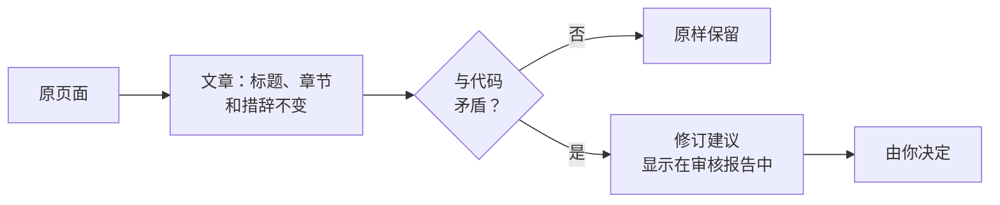

# 原样纳入页面

<!-- context:section id="goal" -->
有些页面必须保留原来的写法，比如团队依赖的值班流程、某项制度，或仍由作者负责维护的运行手册。你仍希望把它们放进自己的知识库：归入你的目录、打进你的知识包，并和它们描述的代码核对。把需求设为**原样纳入**就能做到这一点：每个页面保留原有的标题、章节、顺序和措辞，只有与代码矛盾的段落才会提出修订建议，由你决定是否采纳。


<!-- /context:section -->

<!-- context:section id="ask" -->
## 如何提出

先把资料集登记为[文档来源](../registering-sources/document-directories.md)，并保留它的文件夹结构；如果资料还在持续更新，就把它的仓库和版本记为出处，参见[按版本发布与即将归档的资料](../registering-sources/versioned-external-content.md)。然后告诉 Agent：

```text
把运维 wiki 里的值班页面原样纳入。标题、章节和措辞都保持不变，
并用订单服务和计费服务的代码核对。
```

Agent 会在需求上记下这一点（`preserve_original: true`），并把这些页面描述的代码仓库列为辅助来源，写作时才能引用和核对代码。如果不列出这些仓库，文章只能引用原页面，也就发现不了矛盾。
<!-- /context:section -->

<!-- context:section id="writing" -->
## 写作时会怎么处理

每个原页面对应一篇文章，标题、小节标题、内容顺序和措辞都与原页面一致。每个章节都会引用它复现的原文行，以及这段内容描述的代码。只要不和代码冲突，原有的措辞、风格和结构都不改动。

如果某段内容与代码矛盾，或描述的行为在代码里已经不存在，写作者会把更正后的文字写进文章，同时提出修订建议。原文段落由 Context 直接读取，因此建议里显示的就是原文的准确内容。每条建议都会注明原文是一开始就**写错**了，还是代码后来变了导致**过时**，并给出所依据的代码。
<!-- /context:section -->

<!-- context:section id="decide" -->
## 在审核报告中做决定

[审核报告](reading-review-reports.md)会把修订建议显示在文章上方，包括原文段落、修订后的文字、修订原因和依据。每条建议都可以选择：

| 选择 | 文章 | 原资料 |
| --- | --- | --- |
| 采纳，并同步修正原资料 | 保留修订 | 向页面负责人提出更正，参见[回写上游](../updates-and-versions/writing-back-upstream.md) |
| 只在这里修订 | 保留修订 | 不变 |
| 保留原文 | 恢复原文段落，仍引用代码 | 不变 |

Agent 会把你的选择落实到文章里，记入本批次的 changelog，然后删除这条建议。修订建议只在本批次审核期间存在；审核结束后，这个决定就体现在文章、changelog 和 Git 历史中。

在[全托管](../planning-and-production/managed-mode-and-review-policy.md)运行或[例行更新](../updates-and-versions/scheduled-updates.md)中，Agent 只修订知识库里的文章，并在报告中列出每一处修订，之后你仍可以随时调整。
<!-- /context:section -->

<!-- context:section id="later" -->
## 代码之后发生变化

原样保留的段落仍然引用对应的代码，所以代码之后有变化时，会通过常规的[更新流程](../updates-and-versions/updating-knowledge.md)反映到这篇文章。你已决定保留的矛盾不会再被提出，除非它引用的代码在你做决定之后又有了变化。
<!-- /context:section -->
