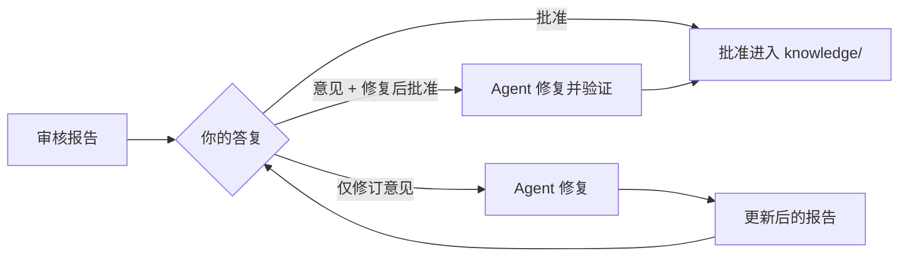

# 阅读审核报告

<!-- context:section id="goal" -->
Agent 写的任何内容，在通过**知识审核**之前都不会成为知识。Agent 会为当前整批候选页面打开一份 HTML 报告，并等待你的答复。这份报告同时决定了发布内容的范围和质量，因此值得带着三个问题来阅读。
<!-- /context:section -->

<!-- context:section id="layout" -->
## 报告里有什么

| 部分 | 展示内容 |
| --- | --- |
| 变更概览 | 本批次的概况，包括现有导航和 Context 知识工作区的预期文件树 |
| 导航 | 每个页面将被放在哪里；没有位置的页面会被标出，以便 Agent 在询问你之前先为它们绑定位置 |
| 页面 | 每个候选页面的标题、路径、摘要和完整的渲染内容，包括图表和来源引用。新页面标记为 *New*；改动的页面会在旧文本旁显示改动的块 |
| 修订意见 | 每个页面都有一个意见框；在其中输入内容即把该页面标记为待修订 |

打开某个页面后，浏览器会将其标记为 READ。已读计数和意见只是本地的便利功能，并不代表批准。修订计数器会列出所有带意见的页面，**Copy** 会把它们连同文章 ID 和标题导出为纯文本，方便粘贴到对话中。
<!-- /context:section -->

<!-- context:section id="three-checks" -->
## 需要判断的三件事

1. **结构**：主题、目录和页面的划分方式，是否符合读者查找内容的习惯？
2. **内容**：页面是否承载了预期的目的、深度和风格？读者真的能借助它们完成页面所承诺的任务吗？
3. **范围**：是否缺少应当纳入的相关材料，或者包含了应当去掉的内容？

仅有引用和位置并不能证明页面有用。请对照来源抽查几个页面，尤其是默认值、条件和步骤。
<!-- /context:section -->

<!-- context:section id="answer" -->
## 答复

直接在对话中答复即可，不需要审核码或特定口令。

| 你说 | 会发生什么 |
| --- | --- |
| 批准，或继续 | 当前呈现的批次获得批准 |
| 仅给出修订意见 | Agent 修复这些页面，检查结果并展示更新后的报告 |
| 修订意见加上“修复后批准” | Agent 修复并验证修复结果，然后只批准约定的页面，不再重复询问 |
| “修好再给我看” | 只做编辑；它会等待你对新报告做出决定 |

沉默、忽略卡片或阅读进度都不等于批准。拒绝某个页面只会把它排除在本批次之外，不会让已批准的文章退役。
<!-- /context:section -->

<!-- context:section id="partial" -->
## 先接收批次中的一部分

你可以先批准已经就绪的页面，同时把其他页面退回修复。仅批准并不会触发构建；如果想在其余页面完成之前先看到已批准页面发布，请要求提前交付。只要这些页面没有链接到仍在等待中的页面，Agent 就会为它们执行 close 和 build，然后回到剩余的审核。
<!-- /context:section -->

<!-- context:section id="after" -->
## 批准之后

批准会把页面写入 `knowledge/`。随后 close 会重建 `knowledge/structure.yaml` 并验证已批准的知识，但不会改写其正文；build 则生成知识包和站点。批准之前不会发布任何内容。
<!-- /context:section -->
