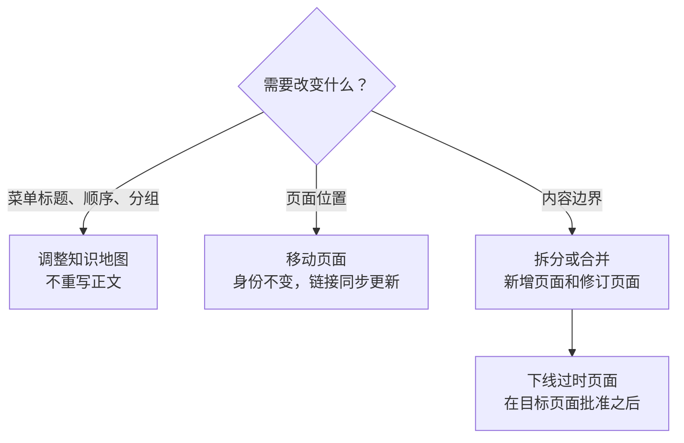

# 大规模重组

<!-- context:section id="goal" -->
第一轮的标题往往偏抽象，最初的目录结构也很少是理想的。请计划在第一轮获得批准后进行一次重组：此时 Agent 可以梳理已有内容，提出一个更易读、更直接的结构。这个方案会优于规划阶段能做到的任何方案，因为内容已经摆在那里。落实之后，再观察一轮。重组是一系列修订，成本远低于重新生产。

```text
请梳理已批准的知识，提出更直接的目录和标题结构。
先给我看调整前后的对比，等我确认后再修订。
```
<!-- /context:section -->

<!-- context:section id="tools" -->
## 选择最轻量的变更



| 变更 | 对 Agent 说什么 | 保持不变的内容 |
| --- | --- | --- |
| 重命名目录、调整顺序、重新分组、把页面放到第二个位置 | *“把 Operations 菜单改名为 Runbooks，并把 Alerts 放在最前面。”* | 文章身份、URL 和正文 |
| 把页面移动到其他路径 | *“把部署页面移到 Source Graph 下面。”* | 身份和章节 ID；其他页面指向它的链接在批准时更新 |
| 拆分一个页面，或合并多个页面 | *“把安装配置页拆成安装和配置两页；合并两个 FAQ 页面。”* | 有用的细节，直到其目标位置获得批准 |
| 删除已在别处覆盖的页面 | *“下线旧指南；让读者转到当前指南。”* | 来源和共享资源 |
<!-- /context:section -->

<!-- context:section id="map" -->
## 知识地图调整

知识地图同时控制网站导航和 LLM Docs 的组织方式。在对话中提出即可：移动某个主题、重命名目录、调整顺序，或为另一种读者任务重新组织同一批文章。这在生产过程中或之后都可以进行，无需重新采集来源。每个条目都有一个稳定的键，因此重命名菜单不需要新文章，移动菜单条目也不会改变文章 URL。

优先顺序如下：修订现有文章，把页面加入匹配的分类，新增一个内容连贯的子分类。**顶层**的新增、重命名或删除会以变更前后的目录树展示给你，并需要你明确批准。
<!-- /context:section -->

<!-- context:section id="split" -->
## 拆分与合并

Agent 会先阅读受影响的页面和当前来源，再决定哪些保留、深化、拆分、合并或下线。目标内容先获得批准；之后才会修订原页面及指向它的链接。有用的条件、步骤和解释在删除任何内容之前都必须有去处。在审核中略去某个页面只会拒绝该草稿，并不会下线已批准的文章。
<!-- /context:section -->

<!-- context:section id="retire" -->
## 下线页面

请 Agent 下线这些页面，并说明每个页面由哪个页面替代以及原因。Agent 会先向你展示将要删除的内容。下线在对话中确认，而不是在审核报告中确认；一旦你批准，Agent 就会直接执行，不再询问。页面及其导航条目会一并删除，其他页面指向它的链接会改指向替代页面；如果你改变主意，Agent 也可以回滚这次下线。指向被拆分页面中某个具体段落的链接会先行修复，因为 Context 无法推断某个段落去了哪里。

具有持续价值的页面，例如旧版本的文档，通常会保留。新文本更短或菜单有变化，都不是下线的理由。
<!-- /context:section -->

<!-- context:section id="record" -->
## 让新结构保持下去

发布前，请检查每个页面都位于其主要读者任务之下、标题与正文相符、同级页面的顺序经过斟酌，且没有空目录或意外重复的目录。请 Agent 在知识工作区的 `AGENTS.md` 中简要记录每个分类的长期意图，以便后续更新以同样的方式放置新页面。
<!-- /context:section -->
