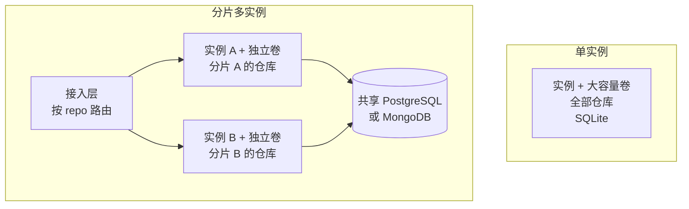

# 部署建议

<!-- context:section id="goal" -->
Source Graph 支持两种部署形态。每个实例在本地磁盘上独占自己的 Git 镜像、搜索索引和数据目录，数据库保存共享的应用状态。因此两种形态的取舍在于磁盘和仓库归属，而不是增加副本。

本文帮助你选择形态，并避开会破坏它的错误做法。构建镜像、选择数据库和备份请见[自部署与数据库选择](self-hosting.md)。
<!-- /context:section -->

<!-- context:section id="choose" -->
## 选择形态

| 问题 | 单实例 + 大磁盘 | 分片多实例 |
| --- | --- | --- |
| 仓库 | Git 镜像加索引能放进一个持久卷 | 一个卷放不下，或希望分摊索引负载 |
| 数据库 | 默认的 SQLite 即可 | 所有实例共享 PostgreSQL 或 MongoDB；SQLite 无法共享 |
| 路由 | 不需要，所有请求都发往这一个实例 | 由接入层把每个请求路由到拥有该仓库的实例 |
| 运维 | 一台机器、一个卷、一份备份 | 每个实例一个卷，仓库映射保持稳定，凭据密钥共享 |

除非已经确定仓库放不下，否则先从单实例开始。之后改为分片需要增加共享数据库和接入层；迁到新实例的仓库会在那里重新拉取并重建索引。

两种形态都应把实例部署在调用它的 Agent 和服务所在的区域。搜索速度来自本地索引，跨区域调用增加的延迟无法靠更大的机器消除。


<!-- /context:section -->

<!-- context:section id="single" -->
## 单实例

- **按裸 Git 仓库加索引估算卷容量。** 剩余空间要始终高于 `SOURCEGRAPH_MIN_FREE_BYTES`（默认 1 GiB），低于这个下限时拉取和索引都会停止。
- **一个卷只配一台机器。** 两个进程绝不能服务同一批仓库或共用一个数据目录，因为索引归属是按进程划分的。
- **保持默认的 SQLite 数据库**，除非你已经在运维 PostgreSQL 或 MongoDB。外部数据库不能替代持久卷，Git、索引和凭据密钥仍保存在卷上。
- **先观察再调整容量。** 索引所需的内存和磁盘取决于仓库大小，先观察真实的索引过程再改容量。
- **重新部署时会短暂中断。** 单实例重启时请求和索引可能短暂中断，持久化的任务会在重启后恢复。
<!-- /context:section -->

<!-- context:section id="sharded" -->
## 分片多实例

- **所有实例共享一个 PostgreSQL 或 MongoDB 数据库**，每个实例各有自己的数据卷。
- **在每个实例上设置相同的 `SOURCEGRAPH_CREDENTIAL_KEY`。** 否则每个实例会在自己的卷上生成密钥，无法解密其他实例保存的凭据。
- **每个仓库只有一个归属实例。** 用一致性哈希或显式的仓库到实例映射表分配仓库，并保持映射稳定。
- **按请求中指定的仓库路由：** HTTP 用 `repo` 查询参数，MCP 工具调用用 `repo` 参数，格式为 `owner/repository`。不针对单个仓库的请求（例如列出仓库）可以发往任意实例。
- **通过增加分片扩容，绝不增加副本。** 在 Fly.io 上就是每个分片一个 App，置于你的路由层之后，而不是在一个 App 里开多台 Machine，因为同一 App 的多台 Machine 会共享仓库。
<!-- /context:section -->

<!-- context:section id="demo" -->
## 示例：公开演示实例

本文档站背后的 Source Graph 是演示用途，不代表容量建议。它以两个 Fly.io App 运行在 `sin` 区域：

| App | 作用 | 机器 |
| --- | --- | --- |
| Portal | nginx，提供首页、Context 文档站和 `llms.txt`，并反代 `/sourcegraph/` | 1 个共享 CPU、256 MB，关闭自动停机，健康检查 `/healthz` |
| Source Graph | 按仓库中的 `fly.toml` 部署的单实例 | 1 个共享 CPU、1 GB，关闭自动停机，数据卷 `sourcegraph_data` 挂在 `/data`，SQLite，开启示例数据，健康检查 `/sourcegraph/healthz` |

Portal 通过 Fly 私网把整个 `/sourcegraph/` 前缀转发到 Source Graph App，因此不需要再经过一次公网，就能在站点自己的域名下访问该实例。同一个实例因此有两个公开入口：

- [https://context4ai-portal.fly.dev/sourcegraph/](https://context4ai-portal.fly.dev/sourcegraph/)，经由 Portal
- [https://context4ai-sourcegraph.fly.dev/sourcegraph/](https://context4ai-sourcegraph.fly.dev/sourcegraph/)，Source Graph App 自身

两个入口下的 MCP 端点都是 `/sourcegraph/mcp`。演示实例以匿名只读方式提供 `context4ai/context` 与 `context4ai/sourcegraph`，每 60 分钟同步一次 `main` 分支。Agent Graph 没有在其中登记，因此知识服务读取它时改用本地检索。

要复现 Source Graph 这一半，先创建 App 和至少 20 GB 的数据卷，再部署一次：

```bash
fly apps create <app-name>
fly volumes create sourcegraph_data --region <region> --size 20 --app <app-name>
fly deploy --remote-only --ha=false
```

如果把它放在另一个站点之后，需要反代整个前缀，并保留查询字符串、Cookie 和授权信息；固定配置好的对外 origin；不要缓存登录、API 或 MCP 响应。演示仓库自己的流水线会在 `main` 构建成功后部署到 Fly。
<!-- /context:section -->
