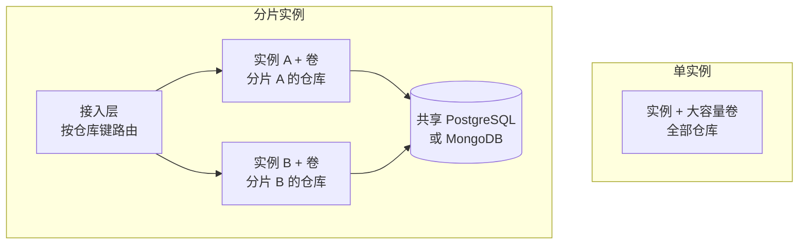

# 自部署与数据库选择

<!-- context:section id="goal" -->
一个 Source Graph 实例就是一个容器或一个进程，外加一个持久化的数据目录。最快的试用方式是使用从仓库构建的 Docker 镜像：

```bash
docker build -t context-sourcegraph .
docker volume create sourcegraph-data
docker run --rm -p 8080:8080 -v sourcegraph-data:/data \
  -e SOURCEGRAPH_ORIGIN=http://localhost:8080 \
  -e SOURCEGRAPH_SEED_DEMO=true \
  context-sourcegraph
```

打开 `http://localhost:8080/sourcegraph/`。设置 `SOURCEGRAPH_SEED_DEMO=true` 后，实例会登记两个公开示例仓库；公开的 GitHub 仓库无需令牌。未配置登录提供方时，站点是匿名且只读的；要管理站点，请添加 Google 或 GitHub 登录，详见[登录与准入](authentication-and-access-control.md)。

镜像包含四个二进制文件：服务 `repo-service`、命令行客户端 `sourcegraph-cli`、Git 凭据助手和 Zoekt 搜索服务器。它以非特权用户运行，数据根目录为 `/data`，暴露 8080 端口。
<!-- /context:section -->

<!-- context:section id="source" -->
## 从源码构建

本地构建需要 Go 1.26 或更高版本、Bun 1.3.9 和 Git：

```bash
bun install --frozen-lockfile
bun run build:web
bun run build
SOURCEGRAPH_DATA_ROOT="$PWD/.tmp/data" SOURCEGRAPH_ORIGIN=http://localhost:8080 output/bin/repo-service
```

构建完成后，`output/bin` 中包含同样的四个二进制文件。服务会自行启动搜索服务器并管理后台建索引，无需运行其他组件。所有设置都是环境变量，列在[配置](../../product/reference/source-graph/configuration.md)中。凭据只能放在环境变量或平台的密钥存储中，绝不要写进部署 JSON、源代码或镜像。
<!-- /context:section -->

<!-- context:section id="topology" -->
## 选择部署拓扑

每个实例在本地磁盘上独占自己的 Git 镜像、搜索索引和数据目录；数据库保存共享的应用状态。搜索速度来自这种数据本地性，因此应按磁盘而非 CPU 规划实例规格，并将实例部署在与调用它的 Agent 和服务相同的区域。



- **单实例加大容量磁盘**最简单，适合一个团队或中等数量的仓库。卷容量要能容纳裸 Git 仓库和索引，并在 `SOURCEGRAPH_MIN_FREE_BYTES`（默认 1 GiB）之上留出余量；可用空间低于该值时，拉取和建索引会停止并返回 `INSUFFICIENT_STORAGE`。
- **按仓库粘性路由的分片实例**可以进一步扩展。多个实例共享一个 PostgreSQL 或 MongoDB 数据库，每个实例从自己的卷上服务一组互不重叠的仓库。接入层按仓库键路由每个请求（HTTP 中的 `repo` 查询参数，MCP 工具调用中的 `repo` 参数），可使用一致性哈希或显式映射表。不绑定单个仓库的请求（例如列出仓库）可以发往任意实例。

分片部署时，在每个实例上设置相同的 `SOURCEGRAPH_CREDENTIAL_KEY`，以便它们能解密彼此存储的凭据，并保持仓库到实例的映射稳定；迁移仓库意味着要重新拉取并建索引。

绝不要让两个实例服务同一个仓库或共享同一个数据目录。索引归属以进程为单位：通过对仓库分片来扩展，而不是增加副本。
<!-- /context:section -->

<!-- context:section id="database" -->
## 选择数据库

| 数据库 | `SOURCEGRAPH_DATABASE` | 适用场景 |
| --- | --- | --- |
| SQLite（默认） | `sqlite` | 单实例。文件默认位于 `/data/sourcegraph.db`，启用预写日志和完全同步提交 |
| PostgreSQL | `postgres` | 分片实例的共享状态，或已有的托管数据库。使用可串行化事务 |
| MongoDB | `mongodb` | 在 MongoDB 上保存共享状态。登录准入需要事务，因此请使用副本集或托管集群 |

通过 `DATABASE_URL` 传入连接信息：SQLite 文件路径、PostgreSQL DSN 或 MongoDB URI。更换数据库不会迁移数据：请从空的目标库开始，或执行经过单独评审的导出与导入。外部数据库无法替代实例的持久化卷，卷上仍保存着 Git、索引和凭据加密密钥。
<!-- /context:section -->

<!-- context:section id="fly" -->
## 示例：Fly.io

仓库中的 `fly.toml` 会部署一台机器：1 GB 内存、一个共享 CPU、关闭自动停机、名为 `sourcegraph_data` 的卷挂载到 `/data`，并在 `/sourcegraph/healthz` 上配置健康检查：

```bash
fly apps create <app-name>
fly volumes create sourcegraph_data --region <region> --size 20 --app <app-name>
fly deploy --remote-only --ha=false
```

卷容量至少从 20 GB 起步，观察实际的建索引情况后再调整容量。不要把一个应用扩展到多台机器，否则它们会共享仓库；如需分片，为每个分片部署一个应用，并放在负责路由的接入层之后。

要在其他站点的域名下提供 Source Graph，请反向代理整个 `/sourcegraph/` 前缀，保留查询字符串、Cookie 和 `Authorization` 请求头，并将 `SOURCEGRAPH_ORIGIN` 设置为公开源站。不要缓存登录、API 或 MCP 响应；静态资源可以缓存。
<!-- /context:section -->

<!-- context:section id="backup" -->
## 备份与恢复

Source Graph 没有内置的备份任务。请将以下四项备份到机器之外，并限制访问权限：数据库、凭据加密密钥、运行时存储配置和仓库元数据。索引和裸 Git 镜像可以从远程仓库重建；身份、设置、凭据及其密钥则无法重建。

- **SQLite**：使用在线备份 API，绝不要单独复制正在运行的 `sourcegraph.db`。例如：`sqlite3 /data/sourcegraph.db '.backup /data/sourcegraph-backup.db'`，然后将结果连同密钥和配置文件复制到别处。也可以先停止服务，再将数据库连同其预写日志一起复制。
- **PostgreSQL**：`pg_dump`。**MongoDB**：使用副本集或托管集群的备份方案。

恢复时，先停止实例，将数据库与其匹配的密钥和配置一起恢复，启动一个实例，然后检查管理员访问、仓库元数据和索引恢复情况。回滚镜像和恢复数据库是两项独立的操作；请保留一个已知可用的镜像，并在升级前做好备份。
<!-- /context:section -->
