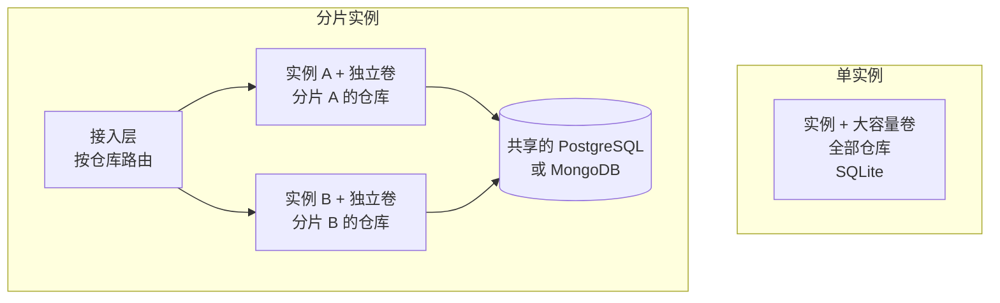

# 自托管

<!-- context:section id="goal" -->
一个 Source Graph 实例就是一个容器或一个进程，外加一个持久化的数据目录。最快的试用方式是使用从仓库构建的 Docker 镜像：

```bash
docker build -t context-sourcegraph .
docker volume create sourcegraph-data
docker run --rm -p 8080:8080 -v sourcegraph-data:/data \
  -e SOURCEGRAPH_ORIGIN=http://localhost:8080 \
  -e SOURCEGRAPH_SEED_DEMO=true \
  context-sourcegraph
```

打开 `http://localhost:8080/sourcegraph/`。设置 `SOURCEGRAPH_SEED_DEMO=true` 后，实例会登记两个公开示例仓库；公开的 GitHub 仓库无需令牌，自定义 Git 托管地址可以在设置中或启动文件里添加，详见 [登记仓库](registering-repositories.md#code-sources)。未配置登录提供方时，站点是匿名且只读的；要管理站点，请添加 Google 或 GitHub 登录，详见 [登录与准入](authentication-and-access-control.md)。

镜像包含四个二进制文件：服务 `repo-service`、命令行客户端 `sourcegraph-cli`、Git 凭据助手和 Zoekt 搜索服务器。它以非特权用户运行，数据根目录为 `/data`，暴露 8080 端口。
<!-- /context:section -->

<!-- context:section id="source" -->
## 从源码构建

本地构建需要 Go、Bun 和 Git，版本以仓库构建文件的要求为准：

```bash
bun install --frozen-lockfile
bun run build:web
bun run build
SOURCEGRAPH_DATA_ROOT="$PWD/.tmp/data" SOURCEGRAPH_ORIGIN=http://localhost:8080 output/bin/repo-service
```

构建完成后，`output/bin` 中包含同样的四个二进制文件。服务会自行启动搜索服务器并管理后台建索引，无需运行其他组件。所有设置都是环境变量，代码源还可以由 `SOURCEGRAPH_CONFIG_FILE` 指定的启动文件覆盖；全部设置列在 [配置](../../product/reference/source-graph/configuration.md) 中。凭据只能放在环境变量或平台的密钥存储中，绝不要写进部署 JSON、源代码或镜像。
<!-- /context:section -->

<!-- context:section id="topology" -->
## 选择部署形态

每个实例都在本地磁盘上拥有自己的 Git 镜像、搜索索引和数据目录，由数据库保存共享的应用状态。因此，选择部署形态关乎磁盘和仓库归属，而不是增加副本。

| 问题 | 单个大磁盘实例 | 分片实例 |
| --- | --- | --- |
| 仓库 | 连同 Git 镜像和索引能放进一个持久化卷 | 一个卷放不下，或者你希望分摊建索引的负载 |
| 数据库 | SQLite（默认）即可 | 所有实例共享的 PostgreSQL 或 MongoDB；SQLite 无法共享 |
| 路由 | 无需路由；所有请求都发往这一个实例 | 由接入层把每个请求路由到拥有对应仓库的实例 |
| 运维 | 一台机器、一个卷、一份备份 | 每个实例一个卷、稳定的仓库映射，以及共享的凭据密钥 |

除非你已经确定仓库放不下，否则先从单实例开始。之后改为分片，意味着增加共享数据库和接入层；迁到新实例的仓库会在那里重新拉取并建索引。

无论哪种形态，都应把实例部署在调用它们的 Agent 和服务所在的区域。搜索速度来自本地索引，跨区域调用增加的延迟无法靠更大的机器消除。


<!-- /context:section -->

<!-- context:section id="single" -->
## 运行单实例

- **按裸 Git 仓库及其索引规划卷容量**。让剩余空间保持在 `SOURCEGRAPH_MIN_FREE_BYTES`（默认 1 GiB）之上，低于这个下限时拉取和建索引会停止。
- **一个卷只对应一台机器**。两个进程绝不能服务同一批仓库或共享同一个数据目录，因为索引归属是按进程划分的。
- **保留默认的 SQLite 数据库**，除非你已经在运维 PostgreSQL 或 MongoDB。
- **先测量再调整规格**。索引所需的内存和磁盘取决于仓库大小，因此先观察真实的建索引情况，再改变容量。
- **重新部署时会有短暂中断**。重启单个实例可能让请求和建索引短暂中断；持久化的任务会在重启后恢复。
<!-- /context:section -->

<!-- context:section id="sharded" -->
## 运行分片实例

- **所有实例共享一个 PostgreSQL 或 MongoDB 数据库**，并为每个实例分配独立的数据卷。
- **在每个实例上设置相同的 `SOURCEGRAPH_CREDENTIAL_KEY`**。否则每个实例会在自己的卷上生成各自的密钥，无法解密其他实例存储的凭据。
- **每个仓库只能有一个归属实例**。用一致性哈希或显式的仓库到实例映射表分配仓库，并保持该映射稳定。
- **按请求中指定的仓库路由**：HTTP 中的 `repo` 查询参数，以及 MCP 工具调用中的 `repo` 参数，格式为 `owner/repository`。不针对单个仓库的请求（例如列出仓库）可以发往任意实例。
- **通过增加分片来扩容，绝不增加副本**。在 Fly.io 上，这意味着每个分片一个 App，放在你的路由层之后，而不是在一个 App 中运行多台 Machine，因为同一个 App 的 Machine 会共享仓库。
<!-- /context:section -->

<!-- context:section id="database" -->
## 选择数据库

| 数据库 | `SOURCEGRAPH_DATABASE` | 适用场景 |
| --- | --- | --- |
| SQLite（默认） | `sqlite` | 单实例。文件默认位于 `/data/sourcegraph.db`，启用预写日志和完全同步提交 |
| PostgreSQL | `postgres` | 分片实例的共享状态，或已有的托管数据库。使用可串行化事务 |
| MongoDB | `mongodb` | 在 MongoDB 上保存共享状态。登录准入需要事务，因此请使用副本集或托管集群 |

通过 `DATABASE_URL` 传入连接信息：SQLite 文件路径、PostgreSQL DSN 或 MongoDB URI。更换数据库不会迁移数据，因此请从空的目标库开始，或执行经过单独评审的导出与导入。外部数据库无法替代实例的持久化卷，卷上仍保存着 Git、索引和凭据密钥。
<!-- /context:section -->

<!-- context:section id="fly" -->
## 示例：Fly.io 与公开演示

仓库中的 `fly.toml` 部署一个实例，数据卷 `sourcegraph_data` 挂载在 `/data`，并在存活端点上配置平台健康检查。要部署你自己的实例，先创建 App 和一个至少 20 GB 的卷，然后部署一次：

```bash
fly apps create <app-name>
fly volumes create sourcegraph_data --region <region> --size 20 --app <app-name>
fly deploy --remote-only --ha=false
```

部署完成后，按 [运维](operations.md#health-and-status) 中的说明检查存活和就绪状态。

本文档站背后的 Source Graph 就是这样部署的。它只是演示，不是容量建议：位于 `sin` 区域的两个 Fly.io App。

| App | 角色 | 机器 |
| --- | --- | --- |
| Portal | nginx 提供首页、Context 文档站和 `llms.txt`，并反向代理 `/sourcegraph/` | 一个共享 CPU，256 MB，关闭自动停止 |
| Source Graph | 由仓库的 `fly.toml` 部署的单个实例 | 一个共享 CPU，1 GB，关闭自动停止，卷 `sourcegraph_data` 挂载在 `/data`，SQLite，开启演示数据 |

Portal 通过 Fly 私有网络把整个 `/sourcegraph/` 前缀转发给 Source Graph App，因此实例可以在站点自身的域名 [https://context4ai.org/sourcegraph/](https://context4ai.org/sourcegraph/) 下访问，无需再经过一次公网跳转。它也可以通过两个 App 各自的 Fly 地址访问：

- [https://context4ai-portal.fly.dev/sourcegraph/](https://context4ai-portal.fly.dev/sourcegraph/)，经由 Portal
- [https://context4ai-sourcegraph.fly.dev/sourcegraph/](https://context4ai-sourcegraph.fly.dev/sourcegraph/)，直接访问 Source Graph App

每个入口下的 MCP 端点都是 `/sourcegraph/mcp`。演示实例以匿名只读方式提供四个仓库，每个都跟随各自的 `main` 分支：

| 仓库 | 来源 |
| --- | --- |
| `context4ai/context`、`context4ai/sourcegraph` | 由演示数据自动登记 |
| `context4ai/portal`、`context4ai/agent-graph` | 由维护者登记 |

`context4ai/portal` 正是本文档站的知识工作区，所以演示实例把知识和它引用的代码放在了一起：Agent 可以远程读取两者，即使只用普通的 MCP 客户端也可以，做法见 [在 Agent 中通过 MCP 查询](../querying-knowledge/querying-via-mcp.md)。演示仓库自身的流水线会在 `main` 构建成功后部署到 Fly。

如果把 Source Graph 放在其他站点之后，请代理整个前缀，并保留查询字符串、Cookie 和授权信息，保持配置的外部源地址不变，且不要缓存登录、API 或 MCP 响应。
<!-- /context:section -->

<!-- context:section id="backup" -->
## 备份与恢复

Source Graph 没有内置的备份任务。请将以下四项备份到机器之外，并限制访问权限：数据库、凭据加密密钥、运行时存储配置和仓库元数据。索引和裸 Git 镜像可以从远程仓库重建；身份、设置、凭据及其密钥则无法重建。

- **SQLite**：使用在线备份 API，绝不要单独复制正在运行的 `sourcegraph.db`。例如：`sqlite3 /data/sourcegraph.db '.backup /data/sourcegraph-backup.db'`，然后将结果连同密钥和配置文件复制到别处。也可以先停止服务，再将数据库连同其预写日志一起复制。
- **PostgreSQL**：`pg_dump`。**MongoDB**：使用副本集或托管集群的备份方案。

恢复时，先停止实例，将数据库与其匹配的密钥和配置一起恢复，启动一个实例，然后检查管理员访问、仓库元数据和索引恢复情况。回滚镜像和恢复数据库是两项独立的操作；请保留一个已知可用的镜像，并在升级前做好备份。
<!-- /context:section -->
