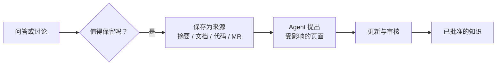

# 从对话中采集

<!-- context:section id="goal" -->
在对话中得出的答案很容易丢失。当一次问答或排障过程确定了值得保留的内容，或者表明知识缺失或已过时，请让 Agent 采集它。你提供的内容会成为来源，Agent 会规划它影响哪些页面，再由常规的 [更新](updating-knowledge.md) 流程把它变成已批准的知识。


<!-- /context:section -->

<!-- context:section id="when" -->
## 当提问发现缺口时

当 [提问](../querying-knowledge/asking-questions.md) 表明知识缺失或已过时，Agent 会建议一次更新，并给出受影响的页面或缺口、建议的改动以及涉及的来源。在你接受之前，不会启动任何操作。接受后，它会把找到的证据带入所选的知识工作区，然后照常执行下面的步骤。

在团队聊天中，知识 Bot 也能做到同样的事；参见 [在团队聊天中使用 Bot](../knowledge-service-agent/using-the-bot-in-team-chat.md#saving-what-you-learned)。
<!-- /context:section -->

<!-- context:section id="what" -->
## 哪些内容可以成为来源

| 你手头有 | 它会成为 |
| --- | --- |
| 本次对话的结论 | 一份 [会话摘要](../registering-sources/notes.md)，可选择关联提交或合并请求 |
| 你粘贴的文本或手头的摘录 | 一条 [笔记](../registering-sources/notes.md) |
| 一份新文档 | 一个 [文档](../registering-sources/document-directories.md) 或 [飞书](../registering-sources/lark-documents.md) 来源 |
| 特定代码或一个合并请求 | 把已登记的 [仓库](../registering-sources/code-repositories.md) 更新到合并后的提交 |

```text
刚才关于重试次数限制的解释是对的。请把这段对话保存为摘要，关联到合并请求，
并更新受影响的页面。
```
<!-- /context:section -->

<!-- context:section id="how" -->
## Agent 会做什么

1. 保存材料。对话会被总结为问题、已确认的决定、原因和未决问题，而不会以完整记录的形式保存。
2. 提出要修订哪些现有页面，以及是否需要新建页面；新建页面会先与你确认。
3. 运行更新，并把改动的页面提交审核。

仅保存来源不会启动任何知识工作，所以你也可以现在保存、稍后再更新。即使摘要在代码处理完之后才到达，也仍然可以更新页面；代码不会被重新处理。
<!-- /context:section -->

<!-- context:section id="boundaries" -->
## 边界

- 只采集你提供或授权的材料；Agent 不会扫描自己的历史记录。
- 关联的合并请求只记录一种关联关系，并不能证明改动已经合并或经过测试。
- 保存对话或批准知识，并不代表批准其中讨论的任何上游改动。
<!-- /context:section -->
