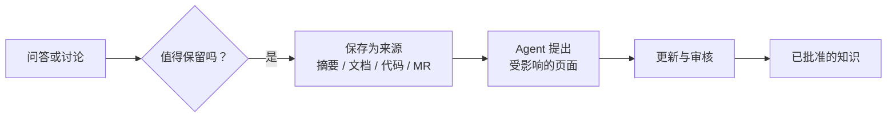

# 从对话中采集

<!-- context:section id="goal" -->
在对话中得出的答案很容易丢失。当一次问答或排障过程确定了值得保留的内容时，请让 Agent 采集它。你提供的内容会成为来源，Agent 会规划它影响哪些页面，再由常规的更新流程把它变成经过审核的知识。


<!-- /context:section -->

<!-- context:section id="what" -->
## 哪些内容可以成为来源

| 你手头有 | 它会成为 |
| --- | --- |
| 本次对话的结论 | 一份[会话摘要](../registering-sources/session-summaries.md)，可选择关联提交或合并请求 |
| 你粘贴的文本或手头的摘录 | 一条[笔记](../registering-sources/notes.md) |
| 一份新文档 | 一个已采集的[文档](../registering-sources/document-directories.md)或[飞书](../registering-sources/lark-documents.md)来源 |
| 特定代码或一个合并请求 | 把已登记的[仓库](../registering-sources/code-repositories.md)更新到合并后的提交 |

```text
That explanation of the retry limits is right. Save this conversation as a
session summary linked to the merge request, and update the affected pages.
```
<!-- /context:section -->

<!-- context:section id="how" -->
## Agent 会做什么

1. 保存材料。对话会被总结为问题、已确认的决定、原因和未决问题，而不会以完整记录的形式保存。
2. 提出计划：修订哪些现有页面，以及是否需要新建页面。新主题会先经过结构审核。
3. 将保存的来源纳入受影响页面的范围并运行更新，然后把改动的页面提交到知识审核。

仅保存来源不会启动任何知识工作，所以你也可以现在保存、稍后再更新。即使摘要在代码处理完之后才到达，也仍然可以更新页面；代码版本会被复用，不会重新解析。
<!-- /context:section -->

<!-- context:section id="when" -->
## 当提问发现缺口时

当查询表明知识缺失或已过时，查询 Skill 会建议一次更新，并给出受影响的页面、建议的改动和来源范围；在你接受之前，它不会启动任何操作。接受后，它会把证据交给所选 Context 知识工作区中的生产入口。请参阅[提问](../querying-knowledge/asking-questions.md)。
<!-- /context:section -->

<!-- context:section id="boundaries" -->
## 边界

- 只采集你提供或授权的材料；Agent 不会扫描自己的历史记录。
- 关联的合并请求只记录一种关联关系，并不能证明改动已经合并或经过测试。
- 保存对话或批准知识，并不代表批准其中讨论的任何上游改动。
<!-- /context:section -->
