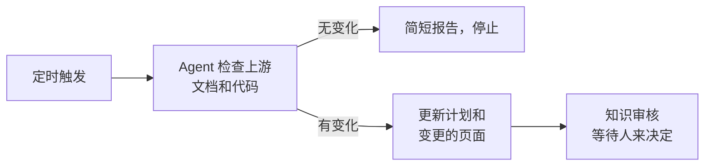

# 定时更新

<!-- context:section id="goal" -->
Context 本身从不轮询变更。要在无人提出请求的情况下保持知识最新，可以安排一次定时的 Agent 运行：在固定时间，Agent 检查已登记的来源自上次已处理基线以来的变更，为发生变化的部分准备更新，并在需要人来决定的地方停下。使用你的 Agent 环境提供的任意调度器即可；关键在于任务指令。


<!-- /context:section -->

<!-- context:section id="prompt" -->
## 编写任务指令

定时提示词在无人值守时运行，因此必须写明原本需要人来回答的内容：

- **范围**——检查哪个 Context 知识工作区，以及哪些来源或模块。
- **无变化**——什么都没变时怎么做，例如输出一行报告。
- **何时停下**——哪些情况需要人：知识审核、新来源、读取失败。
- **交付**——是否构建，以及是否允许发布任何内容。

```text
/c4a:context 请在 ./kb 检查 billing-service 和账单文档，看看与上次处理的版本相比有没有变化。
如果没有变化，回复“无变化”后结束即可；如果有，请准备更新，到 Knowledge Review 时停下来。
请不要发布或提交。
```
<!-- /context:section -->

<!-- context:section id="policy" -->
## 委托审核——或者不委托

默认情况下，运行会在知识审核处停下，由人审核变更的页面。如果信任该自动化自行审核，请把策略代码块放进它实际交给 Agent 的指令中：

```yaml
CONTEXT_RUN_POLICY:
  knowledge_review: delegate
```

委托只对该任务生效，并且不会扩大来源范围、授权发布或绕过永不委托的 Gate。参见[全托管模式与审核策略](../planning-and-production/managed-mode-and-review-policy.md)。
<!-- /context:section -->

<!-- context:section id="what-runs" -->
## 每次运行做什么

每次运行都遵循普通的[更新流程](updating-knowledge.md)：Agent 用自己的 Git 和文档工具获取新的固定版本，提交更新，只修订受影响的页面，并将它们送去审核。未变化的模块树会得出“无知识变更”的结论，而不是生成新页面。无法读取的来源会作为缺口报告；它绝不会被视为变更，也不会成为删除页面的理由。
<!-- /context:section -->
