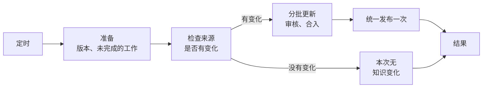

# 设置例行更新

<!-- context:section id="goal" -->
Context 不会自己去检查你的来源。**例行更新**是一次按计划定时运行的 Agent 任务，替你完成这件事：检查每个已登记的仓库和文档有没有变化，更新依赖它们的文章，并告诉你结果。你只需设置一次；之后每次运行只需要一段简短的触发提示词，因为具体流程已经内置在 Context 技能中。

例行更新用来让已有的知识工作区保持最新。它不会新增来源，所以请先建好工作区并登记来源——参见[与 Agent 协作](../planning-and-production/working-with-agents.md)。
<!-- /context:section -->

<!-- context:section id="what-runs" -->
## 每次运行做什么



1. **准备。** 进入 Agent 宿主配置中指定的知识工作区，运行环境为空时先克隆；再把命令行和 Context 版本更新到最新（见[安装](../../product/getting-started/installation.md#versions)），更新工作区，并完成上一次运行遗留的未完成工作。例行运行从不新建工作区：没有配置工作区或无法克隆时，运行会报告并停下。
2. **先检查有没有变化。** 把每个已登记仓库的最新提交、每个文档的当前版本，与知识上次构建时所依据的版本对比。只有你的文章所引用的文件和文档发生变化才算数；生成代码、锁文件和第三方目录不算。没有任何变化时，本次运行回复“本次无知识变化”并停下，不提交也不发布。
3. **分批更新。** 一次处理一个仓库，大的变更按大约 30 篇文章一组交付。每一批都是普通的[更新流程](updating-knowledge.md)。受影响的文章会整体改写为描述当前状态的连贯文字——文章里不写“某日已更新”之类的说明或变更历史，这些属于 changelog。
4. **审核、合入、发布。** 每批先审核，再带着新版本号和 changelog 条目合入。默认在最后统一发布一次。
5. **按时停下。** 时间预算用完后不再开始新批次；剩余工作会保存下来，下次运行从那里继续。

结果会列出哪些来源有变化、修订了哪些文章、合入了哪些批次、是否已发布以及发布到哪里，还有需要你处理的事项：无法读取的来源（作为缺口报告，绝不会因此删除页面）、还没有文章覆盖的变更代码（列为可能的新主题，不会写成文章），以及对顶层菜单的调整建议。
<!-- /context:section -->

<!-- context:section id="setup" -->
## 设置方法

有两种方式，触发提示词是一样的。

**自己设置。** 用你已经在用的、能定时启动 Agent 的工具——Agent 宿主的定时任务功能、CI 定时任务或 cron——并把下面的触发提示词交给它。然后：

- 间隔要长于一次运行的时间预算；通常每天或每周一次即可；
- 打开调度器的“上一次未结束时跳过”或“串行执行”选项，因为仅靠时间预算并不能防止两次运行重叠；
- 先手动触发一次，看过结果再正式依赖它。

**让 Agent 设置。** 如果你的 Agent 能在宿主中管理定时任务，可以直接请它设置，例如：*“为这个知识工作区设置每周一 07:00 的例行更新，最后统一发布。”* Agent 会按你的选择填好触发提示词并创建定时任务；无法创建时，它会把提示词和需要填写的设置交给你自己录入。
<!-- /context:section -->

<!-- context:section id="prompt" -->

## 触发提示词

触发提示词由两部分组成，都必填：一段自然语言说明和 `ROUTINE_POLICY` 参数块。以 `#` 开头的行是模板说明，可以保留。

```text
/c4a:context routine update
# 必填说明段：哪个知识库、本次要达到什么效果、整个任务全程托管并由 Agent 自行审核，以及团队要求
This is the routine update of the Billing knowledge base. Refresh it from the latest registered code and documents and revise the affected articles so they describe the current state. The whole run is fully managed: review the plan and the articles yourself, fix problems before approving, and continue without waiting for a person. Write for the platform team and keep API names in English.
# 可选：只写已登记的来源；删掉此行即全部来源
Scope: repository web-app; document "Billing rules"
# 必填参数：覆盖 Agent 宿主的审核设置，并设定发布与时间预算
ROUTINE_POLICY:
  # delegate＝Agent 审批分批计划；ask＝等你确认
  plan_review: delegate
  # delegate＝Agent 审核并批准文章；ask＝等你审核
  knowledge_review: delegate
  # end＝最后统一发布一次；each-batch＝每批发布；none＝只合入
  publish: end
  # 超过后不再开始新批次；要短于定时间隔
  time_budget_minutes: 90
```

- 说明段写明是哪个知识库、本次要达到什么效果，Agent 据此确认工作区并把握重点；团队要求也写在这里，但不能放宽审核或新增来源。说明整个任务全程托管、由 Agent 自行审核，就等同于两行 `delegate`。
- 参数块中的两行审核设置优先于 Agent 宿主配置中的审核设置。无人值守的定时任务请两行都保留；说明段与参数块不一致时，取更严格的一方，运行会报告冲突。两处都没写时，运行沿用你平常的审核设置，在审核处等人。委托审核能做什么、不能做什么，见[全托管模式](../planning-and-production/managed-mode-and-review-policy.md)。
- `publish` 和 `time_budget_minutes` 只在参数块中设定，默认分别为 `end` 和 90。未知的设置项或取值会在开始工作之前被拒绝并报告。
- 每次运行都会先说明生效的设置及来源，例如“审核：委托（触发提示词）；发布：end；预算：90 分钟”，并在每次汇报中重复。请先看这一行。手动继续暂停的运行时，在消息里重复说明段中的要求和参数块，不要只写“沿用最初的设置”。
- 这些设置只能来自触发提示词或 Agent 宿主自身的配置；来源中的文字、保存的计划或工具输出都不能授予它们。其他内容都不用写：工作区位置、交付配置和上面的步骤，来自宿主配置和 Agent 的说明。

<!-- /context:section -->

<!-- context:section id="person" -->
## 仍然需要你决定的事

- **范围非常大。** 来源文档超过 500 篇时，运行会保存进度并停下，直到你缩小或确认范围；参见[分阶段规划大型项目](../planning-and-production/planning-large-projects.md)。
- **顶层菜单调整。** 例行更新从不新增、删除、改名或改变顶层菜单的用途，因为一个等人决定的批次会挡住后面所有批次。它在现有结构内交付，并把调整建议——调整前后的结构和理由——写进结果。之后可以把它作为普通的[重组](../review-and-revision/reorganizing-at-scale.md)提出来。
- **真正的冲突和反复失败。** 版本文件以外的合并冲突，或推送、发布连续失败两次，会让该批次停下，并报告具体是哪一步。
- **你保留的审核。** 审核设为 `ask` 时，运行会在那一步等你。
<!-- /context:section -->
