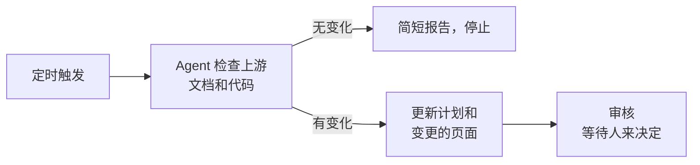

# 定时更新

<!-- context:section id="goal" -->
Context 本身从不自行检查变更。要在无人提出请求的情况下保持知识最新，可以安排一次定时的 Agent 运行：在固定时间，Agent 检查已登记的来源自上次已处理版本以来的变更，为发生变化的部分准备更新，并在需要人来决定的地方停下。使用你的 Agent 环境提供的任意调度器即可；关键在于任务指令。


<!-- /context:section -->

<!-- context:section id="prompt" -->
## 编写任务指令

定时提示词在无人值守时运行，因此必须写明原本需要人来回答的内容：

- **范围**——检查哪个知识工作区，以及哪些来源或模块。
- **无变化**——什么都没变时怎么做，例如输出一行报告。
- **何时停下**——哪些情况需要人：审核、新来源、读取失败。
- **产出**——是否构建，以及是否允许发布或提交任何内容。

```text
/c4a:context 请在 ./kb 检查 billing-service 和账单文档自上次处理的版本以来
有没有变化。如果没有变化，回复“无变化”后停止。否则请准备更新，并在审核处
停下。不要发布或提交。
```
<!-- /context:section -->

<!-- context:section id="policy" -->
## 让 Agent 审核——或者不让

默认情况下，运行会在审核处停下，由人审核变更的页面。如果你信任自动化能自行审核，请把任务审核策略（`CONTEXT_RUN_POLICY`）写进定时提示词本身；没有传达到 Agent 的设置不会生效。该策略只对这个任务生效，绝不会仅仅因为运行是定时触发的就被默认启用。

由 Agent 审核时，它会执行完整的审核，并在批准前修复缺陷——它不会无条件批准、扩大来源范围或授权发布，而那些始终属于人的决策仍会让运行停下。如何编写策略、它能移交什么和不能移交什么，见 [全托管模式](../planning-and-production/managed-mode-and-review-policy.md)。
<!-- /context:section -->

<!-- context:section id="what-runs" -->
## 每次运行做什么

每次运行都遵循普通的 [更新流程](updating-knowledge.md)：Agent 用自己的 Git 和文档工具获取新版本，只修订受影响的页面，并将它们送去审核。未变化的模块会得出“无知识变更”的结论，而不是生成新页面。无法读取的来源会作为缺口报告；它绝不会被视为变更，也不会成为删除页面的理由。

定时运行适用于例行的、有边界的检查。当范围变得非常大时，任务会暂停，直到有人缩小范围或明确保留全部范围，而定时触发无法回答这个问题；这类工作应改为分阶段规划——参见 [分阶段规划大型项目](../planning-and-production/planning-large-projects.md)。
<!-- /context:section -->
