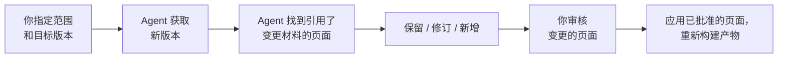

# 更新知识

<!-- context:section id="goal" -->
每个已批准页面都会记录其写作时依据的来源版本。当仓库有了新提交或文档被编辑后，**更新**会将新版本与页面写作时依据的版本对比，只修订受影响的页面，然后把新版本记录为已处理。不受影响的页面保持不变。


<!-- /context:section -->

<!-- context:section id="ask" -->
## 发起更新

指定范围——整个仓库、部分模块或特定文档——必要时再说明版本：

```text
billing-service 已合入 release-2.4，请帮我找到受影响的知识并更新。
这次只处理 invoicing 和 refunds 两个模块。
```

如果只是单个页面的文本有误，更适合用 [修订](../review-and-revision/revising-a-page.md)。如果知识工作区中还有其他未完成的工作，Agent 会告诉你，并在开始一次独立的更新之前询问是先完成还是回滚。
<!-- /context:section -->

<!-- context:section id="acquire" -->
## 如何选定新版本

Context 不会监视平台上的变化；Agent 只会针对你指定的范围，使用它自己的 Git 和文档工具获取一次。

- 对于分支或合并请求，Agent 会确认目标分支、变更是否已合并，以及该分支上的实际提交。未合并的提议不属于主线，而 squash 或 rebase 可能产生与特性分支不同的提交。
- 中间涉及已登记模块的提交都会纳入；revert 也是真实的变更。
- 如果新提交没有改变已登记的模块，可以得出“知识无需变更”的结论。
- 如果在 force push 或历史清理之后旧版本已不可用，Agent 会说明这一点，并改为将当前材料与已批准的知识进行对比。
- 对于文档，读取失败、删除和移动会分别报告；这些都不能作为下线页面的理由。
<!-- /context:section -->

<!-- context:section id="submit" -->
## 哪些页面会变化

Agent 首先找出每一个引用了变更材料的页面。这是有意放宽的范围，而不是必须修改的页面清单：Agent 会阅读变更和每个页面，保留仍然正确的内容，修订发生变化的部分，并为真正的新主题提议新页面。新页面在写作之前会先交给你确认。

如果你没有指定模块，整个已登记的来源都在范围内。
<!-- /context:section -->

<!-- context:section id="review" -->
## 审核与完成

变更的页面会出现在审核报告中，变更的区块与之前的文本并排展示。按 [阅读审核报告](../review-and-revision/reading-review-reports.md) 中的方式批准、评论或要求修改。

当每个选中的修订都已批准、已批准的页面已应用且产物已重新构建——或 Agent 得出无需变更的结论时，更新才算完成。只有到这时，新版本才会被记录为已处理。获取新版本时或第一个页面获批后都不会记录，因此中断的更新可以恢复执行，而不会丢失剩余工作的进度。

在保持不变的页面中，仅在新版本里移动了位置的引用会被自动更新，验证不再报告它们。在全新克隆或另一台机器上也是如此：被引用的文本会从上一次处理的提交中读取，只有在仍然一致时才会使用。如果被引用的文本确实发生了变化或已无法确认，Agent 会在更新完成时列出这些页面；它们的引用仍指向之前的位置。引用项目自身文档或 Skill（同仓库内容）的页面，在该文本变化时也会被列出，尽管它们的引用会更新到当前文本——之后验证不会再标记它们，所以请根据这份列表检查。对列出的页面中需要处理的，用 [修订](../review-and-revision/revising-a-page.md) 逐一修正。完成更新后，知识结构也保持最新，验证不会再要求你重新运行 Close。
<!-- /context:section -->

<!-- context:section id="only-needed" -->
## 只需要更新所用的来源

更新时无需检出不相关的仓库。笔记、仅涉及文档的变更、措辞修正或导航变更完全不需要代码。当所需代码缺失时，Agent 只会在记录的提交上恢复那一个仓库；参见 [代码仓库](../registering-sources/code-repositories.md#checkouts-on-another-machine)。
<!-- /context:section -->
