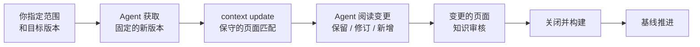

# 更新知识

<!-- context:section id="goal" -->
每个已批准页面都会记录其写作时依据的来源版本。当仓库有了新提交或文档被编辑后，**更新**会将新版本与该基线对比，只修订受影响的页面，然后推进基线。不受影响的页面保持不变。


<!-- /context:section -->

<!-- context:section id="ask" -->
## 发起更新

指定范围——整个仓库、部分模块或特定文档——必要时再说明版本：

```text
billing-service 已合入 release-2.4，请帮我找到受影响的知识并更新。
这次只处理 invoicing 和 refunds 两个模块。
```

如果只是单个页面的文本有误，更适合用[修订](../review-and-revision/revising-a-page.md)。如果 Context 知识工作区中还有其他未完成的工作，Agent 也会告诉你，并在开始一次独立的更新之前询问是先完成还是回滚。
<!-- /context:section -->

<!-- context:section id="acquire" -->
## 如何选定新版本

Context 不会轮询平台，也不会自动发现远端变化；Agent 只会针对你指定的范围，使用它自己的 Git 和文档工具获取一次。

- 对于分支或合并请求，Agent 会确认目标分支、合并状态，以及该分支上的实际提交。未合并的提议不属于主线，而 squash 或 rebase 可能产生与特性分支不同的提交。
- 中间涉及已登记模块的提交都会纳入；revert 也是真实的变更。
- 如果新提交下的模块目录树没有变化，可以得出“知识无需变更”的结论。
- 如果在 force push 或历史清理之后旧基线已不可用，Agent 会说明这一点，并改为将当前材料与已批准的知识进行对比。
- 对于文档，读取失败、删除和移动会分别报告；这些都不能作为下线页面的理由。
<!-- /context:section -->

<!-- context:section id="submit" -->
## 更新请求

```yaml
scopes:
  - requirement_ref: reader-guide
    source_ref: repo:20261012/billing-service
changes: The selected change adds one public option; inspect its explanation and examples.
```

Agent 通过 `context update --input <file>` 提交该请求。省略模块引用时，会选中整个已确认的来源。返回的候选列表是对引用了变更材料的页面所做的保守匹配，而不是必须修改的页面清单：Agent 会阅读变更和当前页面，保留仍然正确的内容，修订发生变化的部分，并为真正的新主题提议新页面，这些新页面会先经过结构审核。
<!-- /context:section -->

<!-- context:section id="review" -->
## 审核与基线

变更的页面会出现在审核报告中，变更的区块与之前的文本并排展示。只有当每个选中的修订都已批准、关闭并构建——或明确得出无需变更的结论之后，已处理的基线才会推进。获取新版本时或第一个页面获批后，基线都不会移动，因此中断的更新可以恢复执行，而不会丢失剩余工作的进度。
<!-- /context:section -->

<!-- context:section id="only-needed" -->
## 只需要更新所用的来源

更新时无需检出不相关的仓库。笔记、仅涉及文档的变更、措辞修正或导航变更完全不需要代码。当所需代码缺失时，Agent 只会在固定的提交上恢复那一个仓库；参见[代码仓库](../registering-sources/code-repositories.md#checkouts-on-another-machine)。
<!-- /context:section -->
