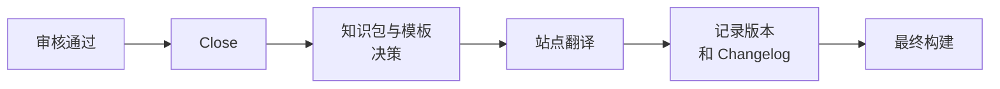

# 版本与 Changelog

<!-- context:section id="goal" -->
Context 知识工作区有自己的版本：`package.json.version`，采用 SemVer。每次完成交付都会记录**一个**新版本和一段简短的 Changelog，知识包、网站和 LLM Docs 都会带上这个版本。中间批次和 worker 结果永远不会单独获得版本。


<!-- /context:section -->

<!-- context:section id="bump" -->
## 哪一位数字会变化

| 交付中的变化 | 递增 |
| --- | --- |
| 新增模块或扩大覆盖范围的材料 | Minor |
| 修正、对现有模块的更新、导航、持久状态 | Patch |
| 你明确称为主版本的任何变化 | Major，仅在你指示时 |

除非知识工作区已有更高的版本或你另行指定，第一个版本是 `0.1.0`。`.tmp/` 下的临时进度永远不会改变版本。
<!-- /context:section -->

<!-- context:section id="record" -->
## 如何记录

Agent 先运行 `context version inspect` 查看正式变更，包括文章正文、资源、结构、导航和模板，然后撰写条目，并通过 `context version record` 提交：

```yaml
expected_digest: "<digest returned by inspect>"
version: 0.2.0
title: Add module recovery guidance
changes:
  - Document recovery conditions and the supported retry flow.
triggers:
  - kind: module
    description: Additional module material requested in this iteration.
```

触发类型包括 `initial`、`note`、`sessions`、`mr`、`module`、`document`、`navigation`、`repair`、`dist`、`translation` 和 `other`。可选的 `actor` 默认取本地 Git 的 `user.name`；Agent 从不猜测身份。每个条目不超过 1500 个可见字符，超出时通过合并相关变更来压缩，而不是截断或拆分。条目中绝不包含凭据、原始对话记录、本地绝对路径或私有账号 ID。

CLI 会同时更新 `package.json`、`changelog.yaml` 和生成的 `CHANGELOG.md`。`version inspect --base <commit-or-tag>` 与指定的 Git 节点进行比较；默认使用当前版本的 `v<version>` 标签，或 `HEAD`。
<!-- /context:section -->

<!-- context:section id="retries" -->
## 重试与重新发布

构建失败时会复用已记录的版本，重试不会递增版本。如果构建失败后必须修改正式内容，可以修订尚未发布的版本。内容一旦发布，后续任何改动都需要更高的版本。仅在本地构建并不会封定版本，而记录版本也从不会提交、打标签、上传或部署任何内容。
<!-- /context:section -->

<!-- context:section id="readers" -->
## 读者在哪里查看

网站有一个历史页面 `changelog.html`：卡片按从新到旧排列，最新的三张展开，较早的折叠。主题切换旁的 History 按钮和页脚的更新时间都链接到该页面。知识包和 LLM Docs 带有相同的版本和 Changelog。
<!-- /context:section -->

<!-- context:section id="restore" -->
## 回到较早的版本

让 Agent 恢复某个版本，例如*“把知识恢复到上周五的状态”*或*“回到上一个版本”*。它会把请求解析为具体的提交和路径范围，放弃未完成的任务状态，用 Git 只恢复约定的知识工作区路径，并恢复该版本固定的来源。它从不重置整个仓库，现有的构建产物在重新构建之前都是过时的。不会自动提交或推送任何内容。
<!-- /context:section -->
