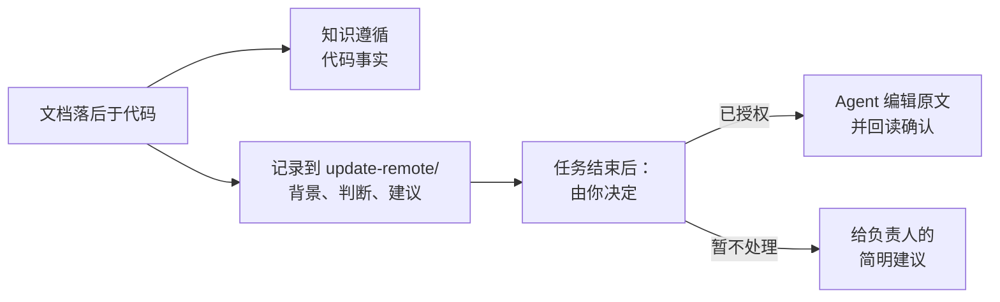

# 回写上游

<!-- context:section id="goal" -->
生产过程会交叉核对各个来源，而文档落后于代码是常态。默认情况下，Agent 依据代码事实修正知识，因此知识是正确的，但原始文档仍然过时。如果你也希望修正原文，可以请 Agent 在过程中收集差异，并在最后统一处理。


<!-- /context:section -->

<!-- context:section id="setup" -->
## 只需提一次

在任务开始时加入这条指令，或者把它永久写进 Context 知识工作区的 `AGENTS.md`：

```text
When a revision is caused by documentation lagging behind the code, record it
in update-remote/<date>-<topic>.md with the context, the judgment and the
suggested change. After the task, work through update-remote: find each
upstream document and either revise it or give a concise suggestion for me
to decide on.
```

这样上游文档就能及时跟上，知识和原文也不会长期脱节。
<!-- /context:section -->

<!-- context:section id="judge" -->
## 原文真的错了吗？

在提议修改上游之前，Agent 会区分三种情况：

| 情况 | 处理方式 |
| --- | --- |
| 知识误解了正确的来源文本 | 只修正本地页面 |
| 已确认的决定尚未写入文档 | 可以先把该决定保存为本地笔记，同时考虑上游修改 |
| 结论仍不确定 | 不会作为事实写到任何地方 |
<!-- /context:section -->

<!-- context:section id="write" -->
## 执行编辑

无论是批准知识还是全托管模式，都不授权远程写入。对于每一处编辑，Agent 都会展示具体文档、受影响的段落、修改前后的文本、原因以及它影响的知识，并使用你已为这处具体编辑给出的授权，或向你申请授权。它会在写入前重新读取该段落，如果有人改动过，只在授权范围内做调整，然后用文档工具写入并回读结果。

修改后的文档随后进入常规的采集和更新流程，使本地快照反映上游的真实内容。如果远程编辑成功但本地构建失败，Agent 会继续完成本地交付，而不是再次编辑。它不会发表评论、通知群组或修改权限；当缺少权限时，它会给你留下一条具体建议。
<!-- /context:section -->
