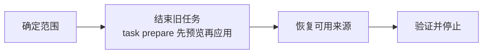

# 准备知识工作区

<!-- context:section id="goal" -->
准备 Context 知识工作区后，它会处于**已登记来源可用、没有未完成任务**的状态，同时保留已批准的知识和配置。你需要明确提出请求——例如“为下一个任务准备这个知识工作区”。清晰的请求即授权了其中描述的任务状态清理；Agent 只会在目标不明确，或涉及你尚未同意的损失时才询问。控制这一行为的开关是 `context.gate.workspace_reset_restore`。


<!-- /context:section -->

<!-- context:section id="capture" -->
## 只想采集文档时

采集指定文档后暂停不属于准备，也不会启动文章生产。Agent 登记来源，报告采集结果后即停止；现有任务、草稿、已批准内容和登记信息都不受影响，也不需要 `task resume`。只有当你请求知识时，生产才会继续。
<!-- /context:section -->

<!-- context:section id="scope" -->
## 1. 确定范围

Agent 用 `context entry` 定位知识工作区，然后查看当前工作、运行中的进程、Git 变更和来源登记情况，并告诉你哪些未完成的草稿和排队中的维护会被丢弃。如果仍有写入进程在运行，它会先等待其结果。`status` 出错时会被排查，而不会被当作知识工作区为空的证据。

已登记的来源不是活动任务。准备不会修复无效快照，也不会改变登记了哪些来源；某个来源没有纳入一次任务，也绝不会删除它的登记信息或证据。
<!-- /context:section -->

<!-- context:section id="end" -->
## 2. 结束旧任务

```bash
context task prepare --format json
```

该命令首先**预览**将被删除的、确切属于 Context 的任务文件——生产、Review 和维护状态。在你同意丢弃这一范围后，Agent 会带上计划摘要运行返回的 apply 命令。如果中途被打断，它会重新运行预览，并使用其返回的恢复命令。

| 删除 | 始终保留 |
| --- | --- |
| 未完成的生产阶段、草稿、Review 状态和排队中的维护 | 已批准页面、来源记录和快照、项目配置、仓库检出、其他 `.tmp` 文件和已有产出 |

其他缓存的清理是可选的。除非你同意舍弃，否则保留报告、独有材料、未知文件和已修改的检出；绝不删除锁、事务记录或活动中的工具目录。保留已登记来源所用的仓库检出——删掉它们会让下次更新不得不重新进行代价高昂的克隆——并保留来源区段基线，更新时靠它区分文本是被移动还是被修改。

应在交付成功**之后**再准备，而不是 close 之后马上准备：记录版本、构建和重试可能仍需要当前任务。交付清理已经会删除已完成的草稿和 Review 状态。
<!-- /context:section -->

<!-- context:section id="sources" -->
## 3. 恢复可用来源

| 来源 | 恢复方式 |
| --- | --- |
| 仓库 | `context source recovery-plan --format json` 列出缺失的内容；匹配的本地检出会被复用，或在获得授权时由 `context source restore --input <file> --format json` 克隆。共享同一远程和提交的模块只克隆一次，并检出到登记的提交——绝不会是更新的提交。你提供的有未提交修改的检出绝不会被重置。 |
| 飞书文档 | 对照来源记录检查已存储的正文和必需的附件，并用文档工具修复。如果当前远程内容与旧快照不同，这属于需要决定的来源更新，而不是恢复。 |
| 笔记、会话摘要、本地文件 | 保留正式的来源内容并检查其路径。丢失的原文绝不会根据生成的知识重建。 |
<!-- /context:section -->

<!-- context:section id="finish" -->
## 4. 验证并停止

当预览显示没有任务文件、没有写入进程在运行、配置可以加载，且所选来源都解析到其登记的版本和路径时，知识工作区就准备好了。Agent 会报告所有阻塞项及其下一步操作，然后停止——它不会开始编写，也不会重新采集全部内容。如果想回到旧版本，参见[恢复版本](./restoring.md)。
<!-- /context:section -->
